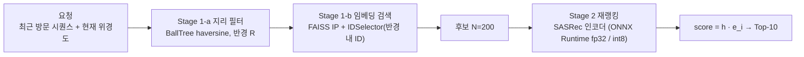

# 동네 반경 제약 순차 추천 + 경량 서빙 — 프로젝트 스펙

> 원본 플랜: `당근 ML 지원용 미니 프로젝트 플랜.pdf` (2026-10-31)
> 초기 설계와 2026-10-31 실험 기록을 담은 문서입니다. 현재 구현 상태와 후속 개발 계획은 [15절](#15-진행-상황과-개발-계획-2026-11-07)에 정리했습니다.
> 초기 일정의 제출 목표는 2026-11-06 전후였고, 서류 마감은 11/13으로 기록했습니다. 아래 일정은 당시 계획이며 실제 제출 여부를 뜻하지 않습니다.

---

## 0. 한눈에 보기

| 항목 | 결정 |
|---|---|
| 레포 이름 (제안) | `dongne-rec` (패키지 `dongne_rec`) |
| 데이터 | Foursquare NYC 체크인 (주), Tokyo는 시간 남으면 재현용 |
| 문제 | 최근 방문 시퀀스 + 현재 위치 → 다음 방문 장소 Top-10 |
| "동네" 정의 | 직전 방문 장소 좌표 기준 반경 **R = 3km** 원 (0일차 EDA로 확정, 민감도 분석 2km·5km) |
| 모델 | 베이스라인 4종(MostPop, GeoPop, ItemKNN, PersonalFreq) + SASRec |
| 핵심 가설 | **H1** 반경 내 negative 학습 효과, **H2** 평가 후보군에 따른 지표 부풀림 |
| 주 지표 | **E4 NDCG@10** (반경 필터 전체 랭킹) — 실제 서비스 화면과 가장 가까운 지표 |
| 서빙 | 지리 필터(BallTree) → FAISS 후보 → SASRec(ONNX fp32/int8) 재랭킹 |
| 환경 | MacBook (Apple Silicon), PyTorch MPS 학습 / CPU 서빙 벤치 |

### 최종적으로 README가 말해야 하는 3가지 주장

1. **"전역 랜덤 후보로 평가하면 성능이 X배 부풀려지고, 모델 순위까지 바뀐다."** (H2)
   → 3일차 기준: SASRec-S0의 E1 ÷ E4 = 3.5(NYC)~4.0(TKY)배, E1로 고르면 S0이 SASRec 중 1등인데 E4에선 꼴찌, 전체 1등은 E1의 SASRec-S0 → E4의 PersonalFreq, Kendall τ(E1, E4) 0.49~0.59
2. **"학습 negative를 동네 안에서 뽑으면 동네 기준 지표가 Y% 오른다 (그리고 이런 trade-off가 있다)."** (H1)
   → 3일차 기준: E4 +1.7~3.5% (TKY 유의, NYC 방향만), 이득은 재방문에서·신규는 소폭 하락(유의하지 않음, false negative는 원인 가설), 전체 랭킹 손실은 혼합 샘플링으로 완화
3. **"2단계 서빙으로 p99 Z ms, int8 양자화 시 정확도 −a% / 속도 +b%."** (서빙)
   → 4일차 기준: 프로세스 내 p99 1.01ms (ONNX int8), 인코더 파일 크기 −74%·측정 NDCG 손실 없음·Stage 2 p50 약 4% 개선. 후보 축소(1-b)는 이 규모에선 정답 보존율을 상대 약 30% 낮췄고, 후보 수가 커질 때 다시 검토할 대상입니다. 10만 개는 합성 벤치의 측정 지점이며 보편적인 전환 기준은 아닙니다.

X, Y, Z, a, b를 채우는 게 이 프로젝트의 전부예요. 아래 모든 스펙은 이 숫자를 정직하게 만들기 위한 장치예요.

### 0일차 결과 (2026-10-31) — 이후 단계가 따라야 할 사실

상세: `results/eda/NYC/eda_report.md`, `results/eda/TKY/eda_report.md` (`make data eda geo`로 재생성)

| | NYC (주) | TKY |
|---|---|---|
| 전처리 후 유저 / 장소 / 체크인 | 1,083 / 9,786 / 163,649 | 2,293 / 14,960 / 454,288 |
| 밀도 | 1.54% | 1.32% |
| 유저당 체크인 median | 103 | 131 |
| 직전→다음 거리 median (전체 / test) | 1.92km / 3.06km | — |
| coverage@3km (전체 / test = E4 HR 상한) | 58.7% / 49.8% | 56.7% / 47.0% |
| 3km 동네 후보 풀 (test 위치 median, 카탈로그 대비) | 1,209 (12.4%) | 1,402 (9.4%) |
| 재방문 정답 비율 (test) | **65.8%** | **71.9%** |

여기서 나온 결정과 스펙 변경:

1. **R = 3km.** 처음 규칙("coverage ≈ 70%")대로면 5km인데, 5km에선 동네 후보 풀이 카탈로그의 34%(median)~49%(p90)라 반경 내 negative와 전역 negative가 비슷해져요. 규칙을 "동네 후보 풀 ≤ 카탈로그의 15%인 반경 중 coverage 최대"로 바꿨어요 (§2.3).
2. **재방문이 2/3를 넘어요.** PersonalFreq(본인 방문 빈도)를 선택이 아닌 필수 베이스라인으로 올렸고, E1/E2의 "이력 제외 negative"가 만드는 부풀림을 H2에 추가했어요 (§3.2, §4).
3. **`max_len` 50 → 100.** 유저의 97%가 50보다 길어서 원 SASRec처럼 유저당 마지막 `max_len`개만 학습하면 데이터 절반 이상을 버려요 (§5.1).
4. **직전 위치 신호는 시간 간격에 크게 좌우돼요.** coverage@3km가 1시간 이내 78%, 24시간 초과 45% → 결과를 시간 간격 구간별로도 리포트 (§3.2).
5. **test 정답은 전체 전이보다 멀어요** (median 3.06km vs 1.92km). 유저별 마지막 체크인이라는 선택 효과라서 README 한계에 적어요.

### 1일차 결과 (2026-10-31) — 베이스라인 test NDCG@10, R = 3km

상세: `results/baselines/{NYC,TKY}/R3/summary.md` (`make baselines`로 재생성)

| NYC | E1 Global-sampled | E2 Geo-sampled | E3 Full | E4 Geo-full ★ | E4 신규 정답 |
|---|---|---|---|---|---|
| MostPop | 0.181 | 0.086 | 0.027 | 0.044 | 0.023 |
| GeoPop | 0.302 | 0.099 | 0.044 | 0.044 | 0.023 |
| **PersonalFreq** | **0.713** | **0.371** | **0.363** | **0.239** | 0.012 |
| ItemKNN (최근 5개, 자기 유사도 포함) | 0.660 | 0.341 | 0.290 | 0.193 | 0.013 |

TKY도 순위와 경향이 같아요 (PersonalFreq E4 0.237, ItemKNN 0.199).

여기서 나온 사실과 결정:

1. **SASRec의 1차 관문은 PersonalFreq (NYC E4 0.239)**예요. 재방문이 66%라 "가 본 곳을 자주 간 순서로"만으로도 가장 강해요. SASRec 같은 next-item 모델은 재방문에 약하다고 알려져 있어서 못 넘을 수도 있어요. 그 경우 숨기지 말고 리포트해요.
2. **신규 정답 구간(E4 신규)이 진짜 승부처예요.** 모든 베이스라인이 NDCG 0.01~0.03 수준이에요. 당근 매물은 같은 물건을 다시 사지 않으니 **신규 구간이 당근 문제에 더 가까워요** → README에서 E4 전체와 함께 핵심 지표로 보고해요.
3. **H2 결과는 예상보다 미묘해요.** E1 ÷ E2 부풀림은 1.9~3.0배지만, 정답이 동네 안인 쿼리만 보면 지리를 안 쓰는 모델(MostPop, PersonalFreq, ItemKNN)은 E1 ≈ E2 (비율 0.97~1.03)예요. 즉 부풀림의 대부분은 ① 반경 밖 정답과 ② 이력 제외 negative(PersonalFreq E1 0.71 vs E3 0.36)에서 오고, **negative의 지리적 난이도 효과는 지리를 아는 모델(GeoPop 2.7배)에서만** 나타나요. SASRec은 공동 방문으로 위치를 암묵적으로 배우므로 어느 쪽인지가 2~3일차의 관전 포인트예요.
4. **E2 정의를 고쳤어요.** 처음 정의에서는 정답이 반경 밖이어도 정답으로 인정했어요. 그러면 negative가 전부 가까운 곳이라 "유일하게 먼 후보 = 정답"이라는 지름길이 생겨요. 지금은 E4처럼 miss로 처리해요 (§3.2).
5. NYC는 test 쿼리의 22%가 반경 안 후보 100개를 못 채워 가까운 순으로 채워요 (TKY 6%). 그 결과 E2에서 GeoPop이 MostPop보다 약간 높아요 (0.099 vs 0.086). 이건 버그가 아니라 채운 후보가 반경 밖이라서 생기는 차이예요.

### 2일차 결과 (2026-10-31) — SASRec-S0 (random negative), 시드 3개 평균 ± 표준편차

상세: `results/summary/{NYC,TKY}/R3/table2.md` (`make compare`), 튜닝 기록: `results/tuning/sasrec/NYC/R3/`

| test NDCG@10 | E1 Global-sampled | E2 Geo-sampled | E3 Full | E4 Geo-full ★ | E4 신규 정답 |
|---|---|---|---|---|---|
| NYC PersonalFreq | 0.713 | **0.371** | **0.363** | **0.239** | 0.012 |
| NYC SASRec-S0 | **0.753 ± 0.004** | 0.370 ± 0.006 | 0.329 ± 0.005 | 0.217 ± 0.004 | 0.019 ± 0.002 |
| TKY PersonalFreq | 0.796 | **0.378** | **0.372** | **0.237** | 0.010 |
| TKY SASRec-S0 | **0.828 ± 0.001** | 0.376 ± 0.005 | 0.296 ± 0.002 | 0.208 ± 0.001 | **0.041 ± 0.002** |

여기서 나온 사실과 결정:

1. **H2의 핵심 증거가 나왔어요: 평가 방식에 따라 1등이 바뀌어요.** 표준 평가(E1)에선 SASRec이 1등인데, 전체 랭킹(E3)과 동네 랭킹(E4)에선 PersonalFreq가 1등이에요. 두 도시 모두 같고 시드 간 표준편차보다 차이가 훨씬 커요. README 주장 1의 중심 문장이에요.
2. **SASRec은 재방문에선 PersonalFreq에, 신규에선 (NYC 한정) 동네 인기순에 져요.** E4 신규 NYC 0.019 vs GeoPop 0.023, TKY는 SASRec이 0.041로 1등. 체크인이 2.8배 많은 TKY에서만 신규 장소 추천이 살아나요.
3. **SASRec은 위치를 암묵적으로 조금 배웠어요.** 정답이 동네 안인 쿼리만 보면 E1 ÷ E2가 1.05(NYC)·1.11(TKY)로, 지리를 안 쓰는 베이스라인(≈1.0)과 GeoPop(2.2~2.7) 사이예요. 동네 안 구분력이 아직 약하다는 뜻이라, **H1(동네 negative)이 노릴 여지가 바로 여기**예요.
4. **하이퍼파라미터는 `hidden 256, dropout 0.3`으로 확정했어요.** NYC valid E4 NDCG@10, S0 seed 0 기준: hidden 64→0.171, 128→0.181, 256→0.189. dropout은 ±0.002 수준이었고, 원 논문식 "마지막 창만 학습"도 0.173으로 차이 없어서 모든 창 학습을 유지했어요. TKY에도 같은 설정을 쓰고, **S1/S2도 이 설정 그대로 비교**해요 (샘플러만 바꾸는 공정 비교).
5. 학습 비용: MPS에서 NYC 1회 35~55초, TKY 1회 2~3분. 3일차 9회 × 2도시도 30분 안쪽이에요.

### 3일차 결과 (2026-10-31) — H1: 동네 negative 샘플링, 시드 3개

상세: `results/summary/{NYC,TKY}/R3/table2.md`, 그림: 같은 폴더의 `fig_protocol_ranks.png`(H2), `fig_sampler_effects.png`(H1)

| test NDCG@10 | E1 Global-sampled | E3 Full | E4 Geo-full ★ | E4 재방문 | E4 신규 |
|---|---|---|---|---|---|
| NYC S0 random | **0.753** | 0.329 | 0.217 | 0.320 | **0.019** |
| NYC S1 geo | 0.703 | 0.297 | 0.221 | **0.327** | 0.017 |
| NYC S2 mixed (α=0.5) | 0.729 | **0.331** | **0.221** | **0.327** | 0.018 |
| TKY S0 random | **0.828** | **0.296** | 0.208 | 0.273 | **0.041** |
| TKY S1 geo | 0.756 | 0.213 | **0.215** | **0.284** | 0.038 |
| TKY S2 mixed (α=0.5) | 0.794 | 0.274 | 0.213 | 0.281 | 0.039 |

S0 대비 E4 변화 (쿼리 단위 paired bootstrap 2,000회, 95% CI): TKY S1 **+3.5% [+1.3, +5.7], p<0.001**, TKY S2 **+2.6% [+0.6, +4.8], p=0.011**, NYC S1 +1.7% [−0.8, +4.3], p=0.19, NYC S2 +1.9% [−0.3, +4.2], p=0.11

여기서 나온 사실과 결정:

1. **H1은 부분적으로 지지돼요.** 동네 negative는 두 도시 모두 E4를 올리지만(+1.7~3.5%), 통계적으로 유의한 건 TKY뿐이에요. NYC는 방향만 같아요. 대가로 전체 랭킹(E3)이 떨어져요 (S1: NYC −9.7%, TKY −28%). **혼합(S2)이 이 손실을 줄여요** (NYC +0.7% 유의하지 않음, TKY −7.3%) → 실전 선택지는 S2예요.
2. **이득은 재방문에서 나오고, 신규 장소는 오히려 소폭 떨어졌습니다.** E4 재방문 +2.2%(NYC, 유의하지 않음)·+4.2%(TKY, p<0.001), E4 신규 −9~−13%(유의하지 않음). 미방문 장소를 negative로 학습하는 false negative 문제가 한 가지 원인일 수 있습니다. 다만 현재 실험으로 원인을 분리해 검증하지는 않았으므로 후속 가설로 남깁니다.
3. **H1 × H2: 표준 평가로 모델을 고르면 동네 서비스에 가장 나쁜 SASRec을 골라요.** E1에선 S0이 SASRec 중 1등인데, E4에선 두 도시 모두 SASRec 중 꼴찌예요. E1 순위와 E4 순위의 Kendall τ = 0.59(NYC)·0.49(TKY). README의 헤드라인이에요.
4. **E4 전체 1등은 여전히 PersonalFreq예요** (SASRec 대비 +7~12%, 모두 p<0.001). 반대로 신규 장소에선 SASRec이 PersonalFreq를 크게 이겨요 (TKY +280~320%, NYC +35~56%). → "재방문은 PersonalFreq, 신규는 SASRec" **혼합 모델**이 자연스러운 다음 실험이에요 (선택).
5. 샘플러 진단 (학습 위치 기준): random negative는 3km 안 8~14%, 중앙 거리 10~11km인데, 실제 다음 장소는 3km 안 57~59%, 중앙 1.9km예요. geo negative는 3km 안 98~99.6%, 중앙 1.9km로 **거리 단서를 지워요.** 정답·이력과 겹친 negative 0건.

### 4일차 결과 (2026-10-31) — 경량 서빙, NYC SASRec-S2 (mixed) seed 0

상세: `results/serving/NYC/R3/mixed_s0/bench.md` (`make export bench`), 프로세스 내·batch=1·test 요청 1,083건, Apple Silicon MacBook

| 인코더 (2단계 구성) | 인코더 크기 | Stage 2 p50 / p99 | E2E p50 / p99 | NDCG@10 |
|---|---|---|---|---|
| PyTorch CPU, 1스레드 | 13.3MB | 0.69 / 1.18ms | 0.90 / 1.83ms | 0.2182 |
| PyTorch MPS | 13.3MB | 1.02 / 1.53ms | 1.26 / 2.20ms | 0.2182 |
| ONNX fp32, 기본 스레드 | 13.4MB | 0.49 / 0.67ms | 0.77 / 1.22ms | 0.2182 |
| **ONNX int8, 기본 스레드** | **3.5MB** | **0.47 / 0.53ms** | **0.73 / 1.01ms** | **0.2186** |

| 파이프라인 구성 (ONNX fp32, 1스레드) | 재랭킹 후보 | 정답이 후보에 남은 비율 | E2E p50 | NDCG@10 | 오프라인 |
|---|---|---|---|---|---|
| 2단계: 지리 필터 → FAISS 200개 → 재랭킹 | 200 | 34.8% | 1.05ms | 0.2182 | E4 0.2209 |
| 지리 필터 → 반경 안 전체 재랭킹 (1-b 생략) | 1,208 | 49.9% | 0.99ms | 0.2218 | E4 0.2209 |
| 지리 필터 없음, 전체 카탈로그 | 9,785 | 100% | 1.78ms | 0.3322 | E3 0.3322 |

여기서 나온 사실과 결정:

1. **서빙 경로가 오프라인 평가와 일치해요.** 전체 카탈로그 재랭킹은 오프라인 E3과 소수점 넷째 자리까지 같고(0.3322), 1-b 생략 구성은 E4와 0.0009 차이예요. 이 차이는 반경 안 장소가 10개 미만이라 반경을 넓힌 0.3% 요청에서 와요.
2. **int8 양자화: 크기 −74%, 정확도 손실 없음, 속도 이득은 거의 없음 (Stage 2 −4%).** 예상대로예요. 인코더 연산이 작아서(hidden 256, 2블록, 길이 100) 실행 시 활성값 양자화 비용이 MatMul 절약분과 비슷해요. 대신 메모리·배포 크기 이득은 커요. 1스레드에선 fp32와 int8 둘 다 0.8ms로 같아요.
3. **batch=1에선 MPS(GPU)가 CPU보다 느려요** (Stage 2 1.02ms vs 0.69ms). 디스패치 오버헤드 때문이에요. 학습(배치 128)에선 MPS가 4배 빨랐던 것과 대비돼요.
4. **이 규모에선 Stage 1-b(FAISS 후보 축소)가 손해예요.** 반경 안 1,208개를 200개로 줄이면, 정답이 후보에 남는 비율이 49.9%→34.8%로 떨어져서 도달 가능한 정답의 30%를 잃어요. 그런데 지연은 똑같아요. 쿼리(최근 3개 장소 임베딩 평균)가 SASRec 표현보다 약한 탓이에요. 다만 NDCG 손실은 −1.6%로 작아요. 잃는 정답이 원래 순위가 낮은 것들이라서요. N을 1000으로 늘리면 41.6%, NDCG 0.2197이에요.
5. **후보 수가 커지면 1-b를 다시 검토할 수 있습니다.** 합성 임베딩 벤치에서 전체 점수 계산은 1만 개 0.05ms, 10만 개 0.84ms, 100만 개 12.6ms였습니다. FAISS IVF 상위 200개 검색은 100만 개에서 0.16ms였습니다. 다만 현재 서빙의 IndexFlatIP와 IVF는 다른 방식이며, 실제 전환 시점은 후보 회수율·하드웨어·인덱스 비용을 함께 측정해 정해야 합니다. 후속 실험에서는 최근 임베딩 평균과 사전 계산한 SASRec 유저 벡터를 비교합니다.
6. **macOS에선 PyTorch와 FAISS를 한 프로세스에 올리면 OpenMP 런타임이 충돌해요** (OMP Error #15 / segfault, FAISS IVF 학습에서 재현). 서빙 경로(`serving/pipeline.py`, `api.py`)는 torch를 import하지 않도록 분리했어요 (`pad_left` → `data/sequences.py`). 벤치는 구성마다 새 프로세스에서 재요. 운영에서도 학습 프로세스와 서빙 프로세스를 나누는 근거로 쓸 수 있어요.
7. **ONNX 변환은 새 exporter(`dynamo=True`)로 했어요.** 예전 TorchScript exporter는 ONNX Runtime이 bool `EyeLike`를 지원하지 않아 실행에 실패했어요. fp32 변환 오차는 6.6e-6이에요.
8. API: `POST /recommend` (FastAPI, ONNX int8 + FAISS, torch 없음). ASGI 테스트 클라이언트 기준 p50 2.3ms / p99 3.2ms예요 (JSON 검증·직렬화 포함, 추천 계산은 약 0.5ms). 실제 네트워크 HTTP 부하 테스트는 하지 않았어요.

---

## 1. 문제 정의

- 유저 u의 체크인 시퀀스 `s_1, s_2, …, s_T` (시간순), 각 장소 `i`는 좌표 `loc(i)`와 카테고리 `cat(i)`를 가짐
- 시점 t의 **현재 위치** `ℓ_t = loc(s_t)` (직전 방문 장소 좌표 — 미래 정보 누출 없음)
- **동네** `N_R(ℓ) = { i : haversine(loc(i), ℓ) ≤ R }`
- 과제: `s_1..s_t`와 `ℓ_t`가 주어졌을 때 `s_{t+1}`을 Top-K로 맞히기
- 당근 매물 추천과의 대응: 장소 ≈ 매물/가게, 체크인 ≈ 상호작용, 반경 R ≈ 동네 범위

---

## 2. 데이터 스펙

### 2.1 원천

- Kaggle "Foursquare NYC and Tokyo Check-ins" (원출처: Dingqi Yang et al., IEEE TSMC 2015 — README에 인용 필수, 비상업 연구용)
- 파일: `dataset_TSMC2014_NYC.csv`, `dataset_TSMC2014_TKY.csv`
- 컬럼: `userId, venueId, venueCategoryId, venueCategory, latitude, longitude, timezoneOffset, utcTimestamp`
- 규모(원본 확인 완료): NYC 227,428 체크인 / 1,083 유저 / 38,333 장소, TKY 573,703 / 2,293 / 61,858, 기간 2012-04-03 ~ 2013-02-16 (UTC), 결측 없음
- 인코딩은 **UTF-8** (latin-1로 읽으면 `Café`가 깨짐), 줄바꿈 CRLF
- 카테고리 이름 251개 / ID 400개 (같은 이름에 ID가 여러 개), 카테고리가 2개 이상 붙은 장소 337곳(NYC) → 최빈값으로 통일
- Kaggle API는 로그인 키가 필요하니 수동 다운로드 후 `data/raw/`에 둬요.

### 2.2 전처리 파이프라인 (`dongne_rec/data/preprocess.py`)

순서대로, 각 단계에서 제거된 행 수를 로그로 남겨요 (README 데이터 표에 그대로 씀).

1. `utcTimestamp` 파싱 (`"%a %b %d %H:%M:%S %z %Y"`), `timezoneOffset`(분)으로 현지 시각 컬럼 추가
2. 유저별 시간순 정렬
3. **연속 중복 제거**: 같은 유저가 같은 장소에 연속 체크인한 경우 첫 번째만 유지 ("다음 = 직전" 정답이 지표를 부풀리는 걸 방지)
4. **장소 좌표 대표값**: 같은 `venueId`의 위경도가 체크인마다 조금씩 달라서 중앙값으로 통일
5. **반복 k-core 필터**: 유저 ≥ 5, 장소 ≥ 5. k-core로 중간 체크인이 빠지면 연속 중복이 다시 생겨서(A→B→A에서 B 제거) 3번과 번갈아 변화가 없을 때까지 반복 (NYC·TKY 모두 4회에 수렴)
6. ID 재매핑: 아이템 `1..N` (venue_id 정렬 순, 0 = padding), 유저 `0..U-1`
7. 산출물 (`data/processed/{city}/`, `make data`)
   - `interactions.parquet` — `user_idx, item_idx, ts_utc, ts_local`
   - `items.parquet` — `item_idx, venue_id, lat, lon, category_id, category, n_checkins` (분할 기준 학습 빈도는 1일차 `split.py`에서 계산)
   - `users.parquet`, `stats.json` (단계별 감소, 좌표 노이즈)
   - `geo_neighbors_R{r}.npz` — 반경 R 이웃 CSR (`indptr, indices`, 자기 자신 포함, `make geo R=r`). R=3km: NYC 54MB, TKY 69MB

### 2.3 EDA 체크리스트 (`src/dongne_rec/analysis/eda.py` → `results/eda/{city}/`) — 결정을 내리기 위한 EDA

노트북 대신 스크립트로 만들어서 `make eda` 한 번으로 리포트·그림이 재생성돼요.

| 질문 | 산출물 | 이걸로 결정하는 것 |
|---|---|---|
| 직전→다음 체크인 거리 분포는? | 거리 CDF 그래프 | **주 반경 R** |
| R별로 다음 장소가 반경 안에 들어올 비율은? (R ∈ 0.5/1/2/3/5/10km) | coverage 표 | R, E4의 HR 상한 |
| R별 반경 내 장소 수 분포는? | 히스토그램 | geo sampler 메모리, Stage 1 후보 수 N |
| 다음 장소가 과거 방문 장소인 비율(재방문율)은? | 숫자 1개 | 재방문/신규 분리 리포트 필요성 |
| 시퀀스 길이 분포는? | 히스토그램 | SASRec `max_len` |
| 연속 체크인 간 시간 간격 분포는? | 히스토그램 | 시간 간격별 분석 구간 |

**R 결정 규칙 (0일차에 수정)**: 후보 1/2/3/5km 중 **동네 후보 풀(test 질의 위치의 반경 내 장소 수 median)이 카탈로그의 15% 이하인 반경에서 coverage가 가장 높은 것**을 주 반경으로, 바로 아래·위 값을 민감도 분석용으로 둬요. 반경을 키우면 정답이 동네 안에 있을 확률은 오르지만 동네가 카탈로그 전체에 가까워져 제약이 무의미해지기 때문이에요. 처음 규칙(coverage ≈ 70%)은 5km를 골랐는데 그때 동네 후보 풀이 카탈로그의 34%였어요. → **결과: R = 3km, 민감도 2km·5km (NYC·TKY 동일)**

---

## 3. 분할과 평가 프로토콜

### 3.1 분할 — 시간순 leave-one-out

- 유저별 마지막 1개 = test, 마지막에서 2번째 = valid, 나머지 = train
- valid 입력: `s_1..s_{T-2}`, 현재 위치 `loc(s_{T-2})` / test 입력: `s_1..s_{T-1}`, 현재 위치 `loc(s_{T-1})`
- 인기도·ItemKNN 유사도·SASRec 학습은 모두 **train 구간(각 유저의 마지막 2개 제외)만** 사용. test 때 valid 정답은 입력 이력으로만 쓰고 통계·학습에는 넣지 않아요 (SASRec이 재학습 없이 test하는 것과 같은 조건)
- 한계(README에 명시): LOO는 유저 간 전역 시간축 누출이 있어요 (다른 유저의 "미래" 체크인이 학습에 포함됨). 시간 남으면 전역 시간 기준 분할로 재검증.

### 3.2 평가 프로토콜 4종 — H2의 실험 장치

| ID | 이름 | 후보군 | 비고 |
|---|---|---|---|
| **E1** | Global-sampled | 정답 + **전역** 랜덤 negative 100개 | SASRec 원 논문 방식. negative는 유저 방문 이력 제외 |
| **E2** | Geo-sampled | 정답 + **반경 R 내** 랜덤 negative 100개 | 정답이 반경 밖이면 miss. 반경 내 부족 시 가까운 순으로 채움 |
| **E3** | Full | 전체 아이템 | 재방문 허용 (이력 마스킹 안 함) |
| **E4** | Geo-full ★ | 반경 R 내 전체 아이템 | 정답이 반경 밖이면 miss. **주 지표** |

- 구조: "샘플링 vs 전체" × "전역 vs 동네"의 2×2. 동네 프로토콜(E2/E4)은 반경 밖 정답을 miss로 둬요. 동네 필터가 있는 서비스에선 노출될 수 없는 장소이고, E2에서 정답으로 인정하면 "유일하게 먼 후보 = 정답"이라는 지름길이 생기기 때문이에요 (1일차에 발견해서 수정)
- **현재 장소(입력의 마지막 장소)는 모든 후보군에서 제외**: 연속 중복을 제거했으므로 정의상 정답이 될 수 없어요
- negative 난이도 효과만 따로 보려고 **정답이 동네 안인 쿼리만** 모은 표도 리포트 (반경 밖 miss 효과 제거)
- 지표: HR@10, NDCG@10 (정답 1개라 `NDCG = 1/log2(rank+1)` if rank ≤ 10), 보조로 MRR
- **동점 처리**: Pop 계열은 동점이 많아요. 정답 순위가 "정답보다 높은 수 + 1" ~ "+ 동점 수" 중 균등하게 나온다고 보고 **그 기댓값**을 계산해요 (`eval/metrics.py`). 무작위 추첨과 기댓값이 같고 시드 노이즈가 없어요. 낙관적 동점 처리는 흔한 버그예요
- 모든 결과를 **재방문 정답 / 신규 정답**으로 나눠서도 리포트 (test 정답의 66%(NYC)·72%(TKY)가 재방문)
- 주요 결과는 **직전 체크인과의 시간 간격 구간**(≤1h / 1–24h / >24h)별로도 리포트 — 직전 위치가 1시간 이내면 강한 신호, 하루 넘으면 약한 신호
- **이력 제외 negative의 함정**: E1/E2는 원 논문 관례대로 유저 방문 이력을 negative에서 빼요. 그러면 재방문 정답은 후보 101개 중 유일한 "가 본 곳"이 되어, 본인 방문 빈도만 보는 모델도 거의 다 맞혀요. 이건 지리와 별개의 부풀림이라 PersonalFreq로 드러내고 H2 결과에 같이 적어요 (E3/E4는 이력을 빼지 않아서 이 문제가 없음)
- E4와 함께 항상 **coverage@R**(정답이 반경 안에 있는 비율 = E4 HR의 상한)을 같이 표기
- E1/E2 sampled negative는 시드 고정 후 **모든 모델이 같은 후보 세트**를 쓰도록 미리 생성해 저장
- 참고: sampled metric의 불안정성 (Krichene & Rendle, KDD 2020) — E3/E4를 같이 두는 이유

### 3.3 통계

- SASRec 계열은 시드 3개(0/1/2) 평균 ± 표준편차
- 핵심 비교(H1: S1 vs S0 on E4)는 유저 단위 paired bootstrap(2,000회)으로 95% 신뢰구간

---

## 4. 베이스라인 스펙 (1일차)

| 모델 | 점수 정의 | 튜닝 (valid E4) |
|---|---|---|
| **MostPop** | `score(i) = train_count(i)` | 없음 |
| **GeoPop** | 반경 R 안: `train_count(i)`, 밖: `train_count(i) − ∞` (반경 밖은 맨 뒤로) | R |
| **ItemKNN** | 유저-아이템 이진 행렬의 아이템 간 cosine (top-100 이웃 유지), `score(i) = Σ_k λ^(k−1) · sim(s_{t−k+1}, i)`, 선택적으로 자기 유사도 1을 더해 재방문 반영 | 최근 L ∈ {1, 5, 전체}, λ ∈ {0.5, 0.8, 1.0}, 자기 유사도 포함 여부 → NYC 최근 5개·λ=1·포함, TKY 전체·λ=1·포함 |
| **PersonalFreq** | 유저 본인 방문 빈도 (동점은 최근 방문 우선), 방문 이력 밖은 MostPop 점수로 이어 붙임 | — |
| (선택) **Markov-1** | `P(s_{t+1}=i \| s_t)` 전이 카운트 | — |

> 예상 포인트: GeoPop은 E1에서 매우 강하게 나올 거예요 (전역 negative 대부분이 멀리 있어서 공짜로 이김). E2에서 그 이점이 사라지는 게 H2의 첫 증거예요. 재방문 정답이 2/3를 넘어서 PersonalFreq는 E3/E4에서도 강한 기준선이 될 거예요 — SASRec이 이걸 넘는지가 첫 번째 관문이에요.

---

## 5. SASRec 스펙 (2~3일차)

### 5.1 모델

- 구조: Kang & McAuley (ICDM 2018) 그대로 — 아이템 임베딩 + 학습형 위치 임베딩 → causal self-attention 블록 × 2 → 마지막 hidden `h`, `score(i) = h · e_i` (입출력 임베딩 공유)
- 어텐션은 ONNX 변환이 쉽도록 `nn.MultiheadAttention` 대신 직접 구현 (QKV linear + causal mask + softmax)
- 입력은 **왼쪽 패딩** 고정 길이 `max_len` (서빙 시 shape 고정을 위해)

| 하이퍼파라미터 | 기본값 | 비고 |
|---|---|---|
| `max_len` | 100 | 0일차 EDA: 유저당 체크인 median 103(NYC)·131(TKY), 97% 이상이 50 초과. 원 SASRec은 유저당 마지막 `max_len`개만 학습하므로, 그래도 짧으면 슬라이딩 윈도로 학습 샘플을 늘리기 |
| `hidden` | **256** | 2일차 튜닝: 64 / 128 / 256 중 valid 최고 (0.171 / 0.181 / 0.189) |
| `n_blocks` / `n_heads` | 2 / 1 | |
| `dropout` | 0.3 | 2일차 튜닝: 0.2 / 0.5와 차이 ±0.002, hidden 256에선 0.5가 더 낮음 |
| `lr` / `batch` | 1e-3 / 128 | Adam |
| `epochs` | 최대 200, 5 epoch마다 valid 평가 | |
| early stopping | valid **E4 NDCG@10**, patience 4회(=20 epoch) | 모든 변형에 동일 기준 |
| loss | BCE, positive 1 : negative 1 | 원 논문 방식 |

### 5.2 Negative sampler — H1의 실험 장치 (`dongne_rec/train/samplers.py`)

각 학습 위치 t (입력 `s_t`, 정답 `s_{t+1}`)마다 negative 1개:

| ID | 이름 | 샘플링 분포 |
|---|---|---|
| **S0** | Random | 전체 아이템 균등 (원 SASRec) |
| **S1** | Geo | `N_R(loc(s_t))` 안에서 균등 — 반경 내가 비면 전역 랜덤으로 대체 |
| **S2** | Mixed | 확률 α로 Geo, 1−α로 Random (기본 α=0.5, 시간 되면 α ∈ {0.25, 0.5, 0.75} 스윕) |

- 공통: negative ≠ 정답, 유저 방문 이력에 있으면 1회 재샘플
- 구현: `geo_neighbors_R{r}.npz` CSR에서 벡터화 샘플링 — `deg = indptr[x+1]-indptr[x]; neg = indices[indptr[x] + floor(rand*deg)]`
- 기대 메커니즘 (README에 그대로 쓸 가설 문장):
  - SASRec은 좌표를 입력으로 받지 않아요. Random negative는 대부분 멀리 있는 장소라 모델이 주로 "가까움 vs 멂"을 배우고, 정작 **동네 안에서 무엇을 고를지**는 덜 배워요.
  - Geo negative는 동네 안 구분을 강제해서 E2/E4가 오를 것으로 예상.
  - 반대로 S1만 쓰면 "먼 곳 배제" 능력을 잃어 E1/E3는 떨어질 수 있음 → **S2가 양쪽을 다 잡는지**가 관전 포인트.
  - 리스크: 동네 안 negative 중 실제로 갈 만한 곳(false negative)이 섞임 → 결과가 기대와 다르면 이걸로 해석.
- (선택) 대조군: 전체 softmax CE loss — 아이템 1만 개 안팎이면 MPS에서 충분히 돌아가요. "샘플링 전략 효과 vs 전체 softmax 상한"을 보여줄 수 있어요.

### 5.3 실험 매트릭스

- 학습: {S0, S1, S2} × 시드 {0, 1, 2} = **9회** (각 수 분)
- 평가: 각 체크포인트 × {E1, E2, E3, E4} × {HR@10, NDCG@10}
- 민감도(시간 되면): 주 반경 R의 아래·위 값으로 S0 vs S1만 재실행

---

## 6. 결과 표/그림 템플릿 (README에 들어갈 형태)

**표 1. 데이터 통계** — 유저 수, 아이템 수, 체크인 수, 밀도, 평균 시퀀스 길이, 재방문율, coverage@R

**표 2. 프로토콜별 성능 (NDCG@10, test)**

| 모델 | E1 Global-sampled | E2 Geo-sampled | E3 Full | E4 Geo-full ★ |
|---|---|---|---|---|
| MostPop | | | | |
| GeoPop | | | | |
| ItemKNN | | | | |
| PersonalFreq | | | | |
| SASRec-S0 (random) | ±  | ± | ± | ± |
| SASRec-S1 (geo) | ± | ± | ± | ± |
| SASRec-S2 (mixed) | ± | ± | ± | ± |
| *coverage@R* | — | — | — | *상한* |

**그림 1.** 직전→다음 체크인 거리 CDF (R 표시)
**그림 2.** 모델별 E1 vs E2 막대 (부풀림 배수 = E1/E2) + 프로토콜별 모델 순위 변화 (Kendall τ)
**표 3.** 재방문 / 신규 정답 분리 성능 (E4)

---

## 7. 경량 서빙 스펙 (4일차)

### 7.1 구조



- **Stage 1-a**: 현재 위치로 반경 R 내 아이템 ID 집합 G. `|G| < k`면 반경을 2배씩 확장 (동네 범위 넓히기와 같은 제품 동작)
- **Stage 1-b**: Transformer를 돌리지 않는 저렴한 쿼리 `q = 최근 3개 아이템 임베딩 평균`으로 G 안에서 top-N. `|G| ≤ N`이면 생략
  - FAISS `IndexFlatIP` + `IDSelectorBatch`(사전 필터)가 기본. 선택 실험: `IndexHNSWFlat` 전역 검색 후 반경 사후 필터와 recall/latency 비교
- **Stage 2**: SASRec 인코더(시퀀스 → h)만 ONNX로 내보내고, 후보 점수 `h · e_i`는 numpy로 계산
- 솔직하게 적을 점: 아이템 수만 개 규모에선 전체 점수 계산도 충분히 빨라요. 2단계 구조의 의미는 (1) 동네 제약을 **hard filter**로 강제, (2) 아이템 수백만 개로 늘어도 버티는 구조 — 를 보이는 거예요.

### 7.2 API (`dongne_rec/serving/api.py`, FastAPI)

```
POST /recommend
{ "recent_item_ids": [int, ...],   // 최대 50개, 오래된 순
  "lat": float, "lon": float,
  "k": 10, "radius_km": R }
→ { "items": [{ "item_id", "venue_id", "category", "distance_km", "score" }, ...],
    "debug": { "n_geo": int, "n_candidates": int, "radius_used_km": float, "latency_ms": {...} } }
```

### 7.3 측정 방법 (`dongne_rec/serving/bench.py`)

- 요청: test 유저 입력에서 1,000건 이상 재생, warmup 100건, batch=1
- 스레드: 공정 비교용 단일 스레드(`torch.set_num_threads(1)`, ORT `intra_op_num_threads=1`) + 기본 멀티스레드 둘 다
- 단계별(1-a / 1-b / 2)과 end-to-end를 `time.perf_counter_ns`로 재고 p50 / p95 / p99 리포트
- 함께 리포트: **Stage 1 recall@N** (정답이 후보 N개 안에 든 비율) — 2단계 구조의 정확도 손실이 어디서 오는지 보여줌
- HTTP 포함 지연(선택): uvicorn 띄우고 간단한 부하 클라이언트로 p50/p99

### 7.4 최적화 표 (README 표 4)

| 변형 | 모델 크기 (MB) | Stage 2 p50 / p99 (ms) | E2E p50 / p99 (ms) | E4 NDCG@10 | Δ vs fp32 |
|---|---|---|---|---|---|
| PyTorch eager fp32 (CPU) | | | | | — |
| PyTorch MPS | | | | | |
| ONNX Runtime fp32 | | | | | |
| ONNX Runtime int8 (dynamic) | | | | | |
| (선택) 전체 카탈로그 점수 (1단계 없음) | | | | | |

- ONNX 변환: `torch.onnx.export`, opset 17, batch 축 dynamic, 변환 후 PyTorch 대비 최대 절대오차 < 1e-4 확인
- int8: `onnxruntime.quantization.quantize_dynamic` (MatMul 가중치 QInt8)
- 예상되는 정직한 결과: hidden 64 / 2블록은 너무 작아서 int8 이득이 거의 없을 수 있어요. 그러면 hidden 256 모델을 하나 더 만들어 "모델이 커질수록 양자화 이득이 커진다"는 추세를 보여주면 돼요. MPS도 batch=1에서는 디스패치 오버헤드로 CPU보다 느릴 수 있어요 — 이것도 그대로 리포트.

---

## 8. 선택 확장 — 카테고리 텍스트 임베딩으로 cold-start 보강

- `venueCategory`(영문, 예: "Coffee Shop")를 `sentence-transformers/all-MiniLM-L6-v2`(384차원)로 인코딩
- 아이템 임베딩 = `W · text_emb(cat(i))` + 학습형 잔차(0으로 초기화), `W: 384 → 64`
- 평가: 5-core 후라 완전한 cold 아이템은 없으니 **롱테일 구간**(train 빈도 하위 20%)이 정답인 test 케이스에서 E4 NDCG@10을 텍스트 초기화 유무로 비교
- 한계: 카테고리가 거칠어서(같은 카테고리 장소가 많음) "내용 기반 prior" 정도의 역할 — 당근 매물이라면 제목·본문 텍스트로 훨씬 강해질 거라는 문장으로 연결

---

## 9. 레포 구조와 기술 스택

```
dongne-rec/
├── README.md                  # 5일차 산출물 (가설 → 실험 → 결과 → 한계 → A/B)
├── PROJECT_SPEC.md            # 이 문서
├── pyproject.toml
├── Makefile                   # make data / baselines / train / eval / bench
├── configs/
│   ├── data.yaml              # city, k-core, radius_km
│   ├── eval.yaml              # protocols, n_neg=100, ks=[10]
│   └── sasrec.yaml            # 하이퍼파라미터, sampler, geo_ratio, seeds
├── data/                      # .gitignore
│   ├── raw/
│   └── processed/{NYC,TKY}/
├── src/dongne_rec/
│   ├── config.py
│   ├── analysis/  eda.py                                  ← 0일차 ✅
│   ├── data/      preprocess.py ✅, geo.py ✅ (haversine, BallTree, CSR 이웃, GeoIndex), split.py ✅
│   ├── baselines/ pop.py ✅ (MostPop, GeoPop, PersonalFreq), itemknn.py ✅, run.py ✅  ← 1일차
│   ├── models/    sasrec.py ✅                              ← 2일차
│   ├── train/     samplers.py ✅ (S0·S1·S2) ← 3일차, trainer.py ✅ (--set/--tag 튜닝)
│   ├── eval/      protocols.py ✅ (E1~E4 후보 생성·평가), metrics.py ✅, report.py ✅, compare.py ✅ (표 2·3, bootstrap),
│   │              stats.py ✅ (paired bootstrap), figures.py ✅ (순위 bump chart, 효과 forest plot)
│   └── serving/   export_onnx.py ✅ (ONNX fp32·int8), pipeline.py ✅ (2단계, torch 없음), bench.py ✅, api.py ✅  ← 4일차
├── tests/
│   ├── test_preprocess.py ✅  # 시간 파싱, 연속 중복, k-core 재수렴, ID/좌표/카테고리
│   ├── test_geo.py ✅         # haversine, 이웃 CSR = brute-force
│   ├── test_eda.py ✅         # 전이 쌍, 반경 결정 규칙, end-to-end
│   ├── test_split.py ✅       # 분할 위치, train에 valid/test 정답 없음 (누출 검사)
│   ├── test_metrics.py ✅     # 손계산 예제 + 동점 기댓값 = 무작위 추첨 시뮬레이션
│   ├── test_protocols.py ✅   # negative 제외 규칙, 반경 채우기, 현재 장소 제외, 반경 밖 miss
│   ├── test_baselines.py ✅   # 각 베이스라인 순서, E4에서 GeoPop = MostPop
│   ├── test_sasrec.py ✅      # 왼쪽 패딩, 학습 창, causal/padding 마스크, toy 데이터 학습
│   ├── test_trainer.py ✅     # config 덮어쓰기, 튜닝 실행 경로 분리
│   ├── test_samplers.py ✅    # S0 패딩·재샘플 비율, S1 반경 내 추출·전역 대체, S2 비율
│   ├── test_stats.py ✅       # paired bootstrap (차이 0, 명확한 개선, 쿼리 난이도 상쇄)
│   └── test_serving.py ✅     # 반경·현재 장소 제외, 후보 축소, 반경 확장, FAISS=numpy (torch 없는 별도 프로세스), ONNX 변환, API
└── results/                   # 실험별 JSONL (config 해시 포함), 표, 그림
```

- 실행 환경: 프로젝트 `.venv` (Python 3.12). `.venv` 안 파일에 macOS hidden 플래그가 붙어 editable 설치의 `.pth`가 무시되는 문제가 있어서, Makefile과 pytest가 `src`를 직접 `PYTHONPATH`에 넣어요. 스크립트를 직접 돌릴 땐 `PYTHONPATH=src .venv/bin/python -m ...`
- Python 3.12, `torch`(MPS), `numpy`, `pandas`, `pyarrow`, `scipy`(희소행렬), `scikit-learn`(BallTree), `faiss-cpu`, `onnx`, `onnxruntime`, `fastapi`, `uvicorn`, `pyyaml`, `matplotlib`, `pytest` / 선택: `sentence-transformers`
- 재현성: 모든 실행에 시드 고정, config를 결과 JSONL에 같이 저장, `make all`로 처음부터 표까지 재생성
- MPS에서 미지원 연산이 나오면 `PYTORCH_ENABLE_MPS_FALLBACK=1`, 모델이 작아서 CPU가 더 빠를 수도 있으니 첫 학습 때 둘 다 재보기

---

## 10. 초기 일정 및 완료 기록

| 날짜 | 단계 | 할 일 | 완료 기준 (DoD) |
|---|---|---|---|
| **10/31(토)** | 0일차 준비 ✅ | 환경 세팅, 데이터 다운로드, 전처리, EDA | 표 1 초안, **R = 3km 확정**, 거리 CDF 그림 |
| **11/1(일)** | 1일차 ✅ (10/31에 앞당겨 완료) | 분할, E1~E4 평가 하네스, 베이스라인 4종, 분할·지표 테스트 | 표 2의 베이스라인 행 채움, `pytest` 통과 (25개) |
| **11/2(월)** | 2일차 ✅ (10/31에 앞당겨 완료) | SASRec 구현, S0 학습, 베이스라인 대비 sanity check | S0 E3 0.329 ≫ MostPop 0.027 ✅, PersonalFreq와의 차이·신규 구간 확인 ✅, 하이퍼파라미터 튜닝 ✅ |
| **11/3(화)** | 3일차 ✅ (10/31에 앞당겨 완료) | S1/S2 sampler, 9회 학습, 표 2·3, 그림 2, bootstrap | 표 2 완성 → **MVP 컷라인 도달** (반경 민감도·α 스윕·혼합 모델은 선택으로 남김) |
| **11/4(수)** | 4일차 ✅ (10/31에 앞당겨 완료) | ONNX 변환, int8, 2단계 파이프라인, FastAPI, 벤치 | 표 4·5 완성, Stage 1 recall@N, N 스윕, 카탈로그 확장 비용 |
| **11/5(목)** | 5일차 ✅ (10/31에 앞당겨 완료) | README 작성, A/B 단락, 그림 정리, 레포 공개 | `README.md` 작성 완료: TL;DR 3가지 주장, 결과 표·그림, 한계, A/B 설계, 재현 방법 |
| **11/6(금)** | 제출 | 최종 검토 후 지원 | — |

**MVP 컷라인**: 11/5 저녁까지 서빙이 덜 끝나면 1~3일차 결과(표 1·2·3 + 그림 1·2)로 README를 마무리해서 먼저 제출하고, 서빙은 인터뷰 전까지 보강해요 (원 플랜과 동일).

---

## 11. 리스크와 대응

| 리스크 | 신호 | 대응 |
|---|---|---|
| SASRec이 ItemKNN/GeoPop을 못 이김 | 2일차 표 | 데이터 규모 한계일 수 있음. 숨기지 말고 "작은 데이터에선 단순 모델이 강하다"를 발견으로 리포트, dropout↑·hidden↓ 시도 |
| SASRec이 PersonalFreq(재방문)를 못 넘음 | 2일차 표 (1일차 기준 E4 0.239) | 재방문 / 신규 구간을 분리해서 SASRec이 신규 구간에서 이기는지로 판단. 시간 되면 "재방문은 PersonalFreq, 신규는 SASRec" 혼합을 대조군으로 |
| H1 효과가 없거나 반대 | 3일차 표 → **부분 발생**: E4는 오르지만 신규 구간은 소폭 하락, NYC는 유의하지 않음 | false negative 해석 + S2 mixed 결과로 trade-off 서술 (3일차 결과 2번). 가설이 기각돼도 근거가 탄탄하면 좋은 결과 |
| 5-core 후 데이터가 너무 작음 | 0일차 | 아이템 ≥ 3으로 완화, 또는 Tokyo로 교체 |
| Manhattan에서 반경 내 장소가 너무 많아 메모리 부족 | 0일차 이웃 수 히스토그램 | CSR int32 사용, 그래도 크면 R 축소 또는 격자 셀 근사 |
| MPS 미지원 연산 / 느림 | 2일차 첫 학습 | fallback env 설정, CPU 학습으로 전환 (수 분 규모라 문제없음) |
| ONNX 변환 실패 | 4일차 → **부분 발생**: 예전 exporter가 `EyeLike` 미지원 | 새 exporter(`dynamo=True`)로 해결, 오차 6.6e-6 |
| PyTorch·FAISS OpenMP 충돌 (macOS) | 4일차 벤치 segfault | 서빙 경로에서 torch 제거, 벤치는 구성별 별도 프로세스 |
| 시간 초과 | 매일 저녁 DoD 체크 | MVP 컷라인 적용, 선택 확장은 제출 후로 |

---

## 12. README 골격 (5일차)

→ `README.md`로 작성 완료. 실제 결과를 반영해서 A/B 설계에 **신규 매물 노출 가드레일**을 추가했어요 (H1에서 동네 negative가 신규 장소 성능을 낮췄기 때문이에요). 당근 SIGIR 2026 논문은 세부 내용을 확인하지 못해서 README에 인용하지 않았어요.

1. **TL;DR** — 3가지 주장, 숫자 포함, 3줄
2. **문제** — 동네 제약이 왜 추천을 어렵게 만드는가 (당근의 문제의식과 연결)
3. **데이터** — 표 1, 거리 CDF, R 선택 근거
4. **가설** — H1, H2를 각각 한 문장 + 예상 메커니즘
5. **실험 설정** — 분할, E1~E4, S0~S2, 시드/통계
6. **결과** — 표 2·3, 그림 2, 핵심 해석 3~4개
7. **서빙** — 구조도, 표 4, Stage 1 recall
8. **한계** — LOO 시간 누출, 체크인 ≠ 거래, 데이터 시기(2012~13)·규모, 위치 = 직전 장소라는 근사, false negative
9. **실서비스라면: 온라인 A/B 설계** (아래 초안)
10. 재현 방법 — `make all`

### A/B 테스트 단락 초안 (공고가 온라인 실험 검증을 강조하므로 비중 있게)

> 오프라인 E4 개선이 실제 가치로 이어지는지는 온라인 실험으로만 확인할 수 있어요. 실서비스라면 다음과 같이 설계하겠습니다.
> - **가설**: 동네 내 negative로 학습한 모델이 동네 추천 지면의 관련성을 높여 전환을 늘린다.
> - **1차 지표**: 추천 지면 노출 대비 클릭 → 채팅 시작(거래 의도) 전환율 (유저 단위 집계). POI 맥락이라면 방문 전환.
> - **보조 지표**: 세션당 탐색 깊이, 7일 재방문.
> - **가드레일**: p99 latency, 신규 매물(cold-start) 노출 비중, 판매자 측 노출 집중도(Gini), 숨김/신고율.
> - **랜덤화 단위**: 기본은 유저 단위. 다만 같은 동네의 매물과 구매자가 서로 경쟁하는 양면 마켓이라 처치군의 행동이 대조군 노출에 영향을 줄 수 있어(간섭), 효과가 크면 지역(동네 클러스터) 단위 랜덤화로 교차 검증.
> - **기간·검정력**: 요일 효과를 덮도록 최소 2주, 사전에 MDE와 표본 수 계산, 초기 novelty 효과는 첫 주를 따로 분석.
> - **오프라인-온라인 정합성**: E1이 아닌 E4가 온라인 지표와 같은 방향으로 움직이는지 확인하는 것 자체가 이 프로젝트 H2의 실전 검증.

---

## 13. 인터뷰 대비 포인트

- **왜 sampled metric이 위험한가?** → E1 vs E2/E3 결과로 답하기, 순위 뒤집힘 사례
- **geo negative의 false negative는?** → S2 mixed와 재방문/신규 분리 결과로 답하기
- **동네 제약을 hard filter로 넣을지 모델 feature로 넣을지?** → 이 프로젝트는 hard filter(서빙) + 학습 분포 조정(sampler). feature 방식(거리 임베딩, 위치 인코딩)은 후속 과제
- **2단계에서 잃는 정확도는?** → Stage 1 recall@N과 E2E vs E4 차이
- **int8이 왜 (안) 빨라졌나?** → 모델 크기, 연산 비중(임베딩 조회 vs MatMul), 스레드 설정
- **당근 실데이터라면 뭐가 다른가?** → 매물은 팔리면 사라짐(아이템 수명 짧음 → cold-start 상시), 판매자-구매자 양면성, 동네 인증으로 위치 신뢰도가 높음, 텍스트·이미지 등 콘텐츠 신호가 풍부함
- **당근의 SIGIR 2026 논문과의 연결** → "이용자가 경험할 수 있는 범위 안의 학습 데이터"라는 문제의식을 공개 데이터의 negative 샘플링 분포 문제로 작게 재현한 것 (논문 세부 내용은 지원 전에 직접 읽고 정확히 인용)

---

## 14. 출처

- 당근 채용 공고 – Software Engineer, Machine Learning
- 바이라인네트워크, "당근의 추천시스템은 LLM 안 부럽다"
- Kang & McAuley, *Self-Attentive Sequential Recommendation*, ICDM 2018
- Krichene & Rendle, *On Sampled Metrics for Item Recommendation*, KDD 2020
- Yang et al., *Modeling User Activity Preference by Leveraging User Spatial Temporal Characteristics in LBSNs*, IEEE TSMC 2015 (데이터셋)

---

## 15. 진행 상황과 개발 계획 (2026-11-07)

이 절은 현재 작업 폴더의 코드, 설정, 저장된 결과를 기준으로 정리했습니다. 기존 실험과 벤치마크를 이번에 다시 수행한 것은 아닙니다. 문서 정리 과정에서 `make test`를 실행했고, 47개 테스트가 모두 통과했습니다. FastAPI 테스트 클라이언트의 의존성과 관련된 deprecation 경고 1건이 남아 있습니다.

### 15.1 현재까지 완료한 작업

| 영역 | 확인한 구현과 산출물 | 현재 판단 |
|---|---|---|
| 데이터 | NYC·TKY 전처리, 반복 k-core·연속 중복 제거, EDA, 3km 이웃 인덱스. `results/eda/{city}/` | 두 도시 실험에 필요한 파이프라인 구현 완료 |
| 평가 | 이용자별 leave-one-out, E1~E4, 이력 제외 sampled 후보 공유, 동점 기댓값, 재방문·신규·시간 간격별 분석 | 평가 후보에 따라 모델 선택이 바뀐다는 결과 확보 |
| 베이스라인 | MostPop, GeoPop, PersonalFreq, ItemKNN 및 valid 튜닝. `results/baselines/{city}/R3/` | E4 전체에서는 PersonalFreq가 가장 높음 |
| SASRec | 2도시 × 3샘플러 × 3시드 = 18회 본 실험, NYC 튜닝 기록. `results/sasrec/`, `results/tuning/` | geo 샘플링의 E4 개선은 TKY에서 유의, 신규 구간 개선은 확인하지 못함 |
| 비교 리포트 | 시드별 평균·표준편차, paired bootstrap 2,000회, 순위·샘플러 효과 그림. `results/summary/{city}/R3/` | H1·H2 결과와 한계를 설명할 근거 확보 |
| 서빙 | ONNX fp32/int8, BallTree·FAISS 파이프라인, FastAPI, NYC mixed seed 0 벤치. `results/serving/NYC/R3/mixed_s0/` | 프로세스 내 지연 확인. 현재 규모에서는 후보 축소의 이득이 없음 |
| 문서·검증 | README 문체·결과 해석·진행 현황 정리, 테스트 47개 통과 | MVP 구현과 기본 검증 완료. 후속 실험과 운영 검증은 남아 있음 |

현재 가장 중요한 결론은 복잡한 모델이 항상 더 좋은 결과를 내지는 않는다는 점입니다. PersonalFreq가 E4 전체에서 앞서고, SASRec의 장점은 도쿄의 신규 장소 구간에서 드러납니다. 다음 개발은 이 차이를 설명하고 활용하는 방향으로 진행합니다. 여기서 신규는 이용자에게 미방문인 장소이며, 학습에 없던 아이템의 cold-start와는 다릅니다.

### 15.2 실험 기반과 서빙 과제

1. 새 학습과 베이스라인 평가의 저장 경로를 실행 단위로 분리했습니다. 비교 명령에서 경로를 선택하면 샘플러나 α 설정이 다른 실행을 별도 행으로 표시합니다.
2. 이웃 인덱스는 좌표와 반경을 기준으로 구분합니다. 평가 후보는 데이터·분할·이웃 인덱스·후보 설정의 지문을 기준으로 구분합니다.
3. `R`을 이웃 생성, 학습, 평가, 비교, ONNX 변환과 벤치에 전달합니다.
4. API와 벤치는 동일한 서빙 설정에서 아티팩트와 후보 정책을 선택합니다. 기본값은 고정 반경과 동네 전체 재랭킹입니다.

### 15.3 개발 순서와 완료 기준

예상 작업량은 기존 환경과 데이터가 준비된 상태에서의 범위입니다. 1~4단계를 마쳤고, 다음은 HTTP 부하 검증입니다.

| 순서 | 작업 | 예상 작업량 | 완료 기준 |
|---|---|---|---|
| 1 | 재현성·실험 식별자 정리 (11/09 완료) | 0.5~1일 | 환경 버전 기록, 의존성 고정, 결과 덮어쓰기 방지, 데이터·분할별 캐시 분리 |
| 2 | 서빙 기본 정책과 평가 조건 정리 (11/09 완료) | 0.5일 | 동네 전체 재랭킹을 기본값으로 제공, 후보 축소·반경 확장을 명시적으로 선택, 동일 조건에서 오프라인 지표 대조 |
| 3 | 반경·혼합 비율 민감도와 시간 분할 검증 (11/09 완료) | 1~2일 | valid에서 설정 선택, 두 도시 비교표, coverage·신규/재방문·불확실성 보고 |
| 4 | 이력 기반 혼합 모델 (11/09 완료) | 1일 | 정답 정보를 쓰지 않는 점수/순위 결합, 단일 모델 대비 E4 전체·신규·재방문 비교 |
| 5 | HTTP 부하 검증과 결과 문서 갱신 | 0.5~1일 | 동시성별 p50·p95·p99, 처리량·오류율·자원 사용량, README 결과 갱신 |

### 15.4 단계별 작업

**1단계 — 재현성과 결과 관리 (2026-11-09 완료)**

- macOS arm64·Python 3.12.12에서 검증한 패키지 60개의 버전을 고정했습니다. 각 실행의 `metadata.json`에는 전체 설정, Git 커밋과 작업 트리 변경 여부, 데이터·분할 지문과 실행 환경을 기록합니다.
- 같은 설정과 시드는 `experiment_id`로 묶고, 실행마다 `run_id`를 부여합니다. 비교 리포트의 `inputs.json`에 선택한 실행을 남깁니다. 초기 결과는 기존 형식으로도 조회할 수 있습니다.
- 이웃·후보 캐시를 내용에 따라 구분하고 저장을 완료한 파일과 실행 디렉터리를 공개합니다. 학습과 평가 명령에 같은 반경을 전달할 수 있습니다.
- 새 가상환경에서 뉴욕 CSV부터 2km 베이스라인, 1 epoch 학습, 비교 리포트, ONNX 변환을 실행했습니다. α가 다른 실행과 같은 설정의 재실행이 별도 경로에 저장되는 것을 확인했습니다. 기존 3km 비교표의 수치를 재현했고 테스트 50개가 통과했습니다.

**2단계 — 서빙 정책 정리 (2026-11-09 완료)**

- 기본 경로를 고정 반경 안의 전체 재랭킹으로 바꿨습니다. `retrieval: faiss`로 후보 축소를 선택할 수 있고, `radius_mode: expand`에서 후보가 부족하면 상한까지 반경을 두 배씩 넓힙니다. 응답에 마지막으로 검색한 실제 반경을 기록합니다.
- API와 벤치에서 같은 설정과 아티팩트를 사용했습니다. 뉴욕의 후보가 밀집한 요청에서 기본 경로는 3,604개를 재랭킹했고, FAISS 옵션은 200개를 재랭킹했습니다. 후보가 부족한 요청에서는 고정 모드가 3km, 확장 모드가 12km를 사용했습니다.
- 뉴욕 3km test 1,083건에서 고정 반경 FP32의 E4 NDCG@10은 0.2209, HR@10은 0.3112였고 오프라인 값과 일치했습니다. 확장 모드는 3건에서 반경을 넓혔고 FP32 NDCG@10은 0.2218이었습니다. 같은 고정 반경 구성의 int8 NDCG@10은 0.2210이고 인코더 파일 크기는 13.4MB에서 3.5MB로 줄었습니다.
- MPS에서 동일한 고정 반경 정책을 실행해 batch 1의 프로세스 내 p50 1.35ms, p99 2.07ms를 측정했습니다. 빈 후보, 확장 상한, 동점 처리와 설정 연동을 포함해 테스트 53개가 통과했습니다. [서빙 검증 리포트](results/serving/NYC/R3/mixed_s0/bench-20261109T101321387285Z-b3f6664b6034/bench.md)

**3단계 — 기존 결론의 적용 범위 확인 (2026-11-09 완료)**

- 시드 0·1·2로 2·5km 학습 36회, 3km의 α=0.25·0.75 학습 12회, 3km 전역 시간 분할의 S0·S1·S2 학습 18회를 MPS에서 수행했습니다. 초기 3km 체크포인트 18개의 MPS 재평가도 기존 NDCG@10과 일치했습니다.
- 두 도시 모두 5km에서 정답 포함률과 PersonalFreq·SASRec의 전체 E4가 가장 높았습니다. 이 모델들의 E4는 정답이 반경 안에 있는 요청만 집계하면 2km에서 가장 높았습니다. 3km의 추가 α 두 값은 기존 α=0.5와 비교한 E4 차이의 95% 신뢰구간에 0을 포함했습니다.
- 전역 시간 분할은 2012-12-01과 2013-01-01의 UTC 경계를 사용합니다. 학습 기간으로 k-core와 카탈로그·좌표를 확정하고, 평가 기간마다 학습 이용자의 첫 추천 가능 시점을 평가했습니다. 요청 이전에 등록된 방문 이력을 사용하고 미등록 정답은 miss로 계산했습니다.
- 전역 분할에서도 PersonalFreq가 양쪽 E4 1위였고, E1과 E4의 1위 역전은 뉴욕에서 유지됐습니다. 도쿄의 S2는 S0 대비 E4 +5.4%였고 95% 신뢰구간은 절대 차이 [+0.0015, +0.0083]이었습니다. 뉴욕에서는 S1·S2의 전체 E4 차이 구간이 0을 포함했습니다.
- 92개 입력 실행, 모델과 분할별 지표, 124개 paired 비교, 반경·α 그래프를 저장했습니다. 시간 누출과 미등록 정답 처리를 포함해 테스트 55개가 통과했습니다. [실험 리포트](results/reports/sensitivity/stage3-20261109T112330626325Z-6fd4b60917f0/report.md)

**4단계 — 이력 기반 혼합 모델 (2026-11-09 완료)**

- 두 도시와 두 분할의 3km E4에서 PersonalFreq와 SASRec S0·S2를 각각 결합했습니다. 반경 내 후보의 평균 동점 순위를 사용해 `1/(60+순위)`를 가중합했습니다. 방문 후보와 미방문 후보의 가중치는 요청 시점 이력으로 결정합니다.
- 121개 가중치 쌍을 탐색하고, 도시·분할·SASRec 조합별로 세 시드의 valid E4 평균이 가장 높은 쌍을 선택했습니다. 여덟 쌍을 저장한 뒤 test를 평가했습니다. 3단계 체크포인트 24개로 MPS 추론했고 단독 모델의 쿼리별 E4는 이전 결과와 일치했습니다.
- 도쿄 leave-one-out의 Hybrid-S2가 PersonalFreq 대비 전체 E4 +0.0022였고 보정 전 95% 신뢰구간은 [+0.00007, +0.0044]였습니다. 신규 E4는 0.0218로 단독 S2 0.0391보다 낮았습니다. 전역 분할의 전체 E4 개선은 확인되지 않았고 네 비교 그룹 모두 신규 최고점은 단독 모델이 기록했습니다.
- 전체·재방문·신규·등록 신규, 미방문 후보 노출 비중, 고유 노출 장소 수와 128개 paired 비교를 저장했습니다. 이력과 동점·미등록 정답 처리를 포함해 테스트 57개가 통과했습니다. [실험 리포트](results/reports/hybrid/stage4-20261109T114150384703Z-2ad563011594/report.md)

**5단계 — 실제 HTTP 부하와 웹 데모 (2026-11-09 완료)**

- NYC 고정 3km의 ONNX int8 모델을 Uvicorn 워커 하나로 띄워 동네 전체 재랭킹과 FAISS 200을 비교했습니다. 동시성 1·4·16에서 valid 200건으로 워밍업하고 같은 test 1,000건을 조건마다 3회 측정했습니다. 18,000건 모두 성공했습니다.
- 추천 내부와 HTTP 전체의 p50·p95·p99, 성공 처리량, 오류율, 서버 CPU와 최대 RSS를 분리해 기록했습니다. 두 정책 모두 동시성 4에서 처리량이 가장 높았고, HTTP p99는 동시성 16에서 각각 194.88ms와 226.43ms였습니다. [HTTP 리포트](results/serving/NYC/R3/mixed_s0/http-20261109T120102207482Z-0d8401ca6914/http.md)
- 뉴욕 합성 방문 시나리오에서 반경 2·3·5km와 후보 정책을 바꿔 볼 수 있는 정적 웹 데모를 Cloudflare Pages에 공개 배포했습니다. 실제 `/recommend`로 미리 계산한 결과를 사용합니다. [공개 HTTPS 데모](https://dongne-rec-lab.pages.dev/)

### 15.5 후순위 확장

- **유저 벡터 기반 검색:** 후보 수가 커질 때 최근 임베딩 평균과 사전 계산한 SASRec 벡터를 비교합니다. 캐시 갱신 주기·벡터 노후화·인덱스 메모리·후보 회수율·전체 지연을 함께 측정합니다. IVF 등 근사 검색은 현재 Flat 검색과 구분합니다.
- **false negative 원인 검증:** 학습 시점에 사용 가능한 정보로만 negative 가중치나 추출 확률을 바꿉니다. 향후 정답을 제외 목록으로 쓰지 않고, 신규 구간 변화와 negative 진단을 통해 현재 원인 가설을 검증합니다.
- **위치·시간 신호:** 거리와 직전 방문 이후 경과 시간을 모델 입력에 추가하고, hard filter와의 조합을 비교합니다.
- **cold-start:** 카테고리 텍스트 임베딩을 도입하기 전에 학습에 없던 아이템을 평가하는 분할과 초기화 정책을 정의합니다. 현재의 이용자별 미방문 장소 결과와 별도 지표로 보고합니다.
