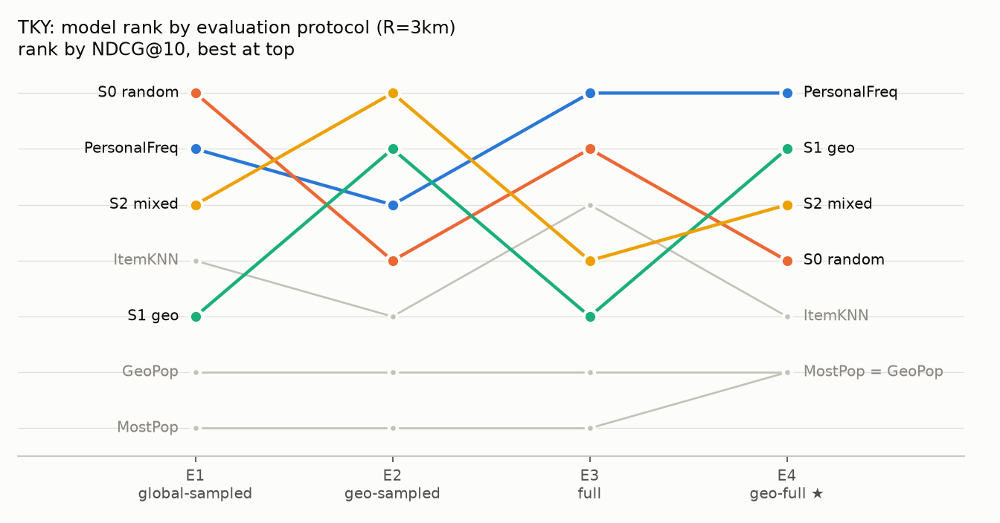
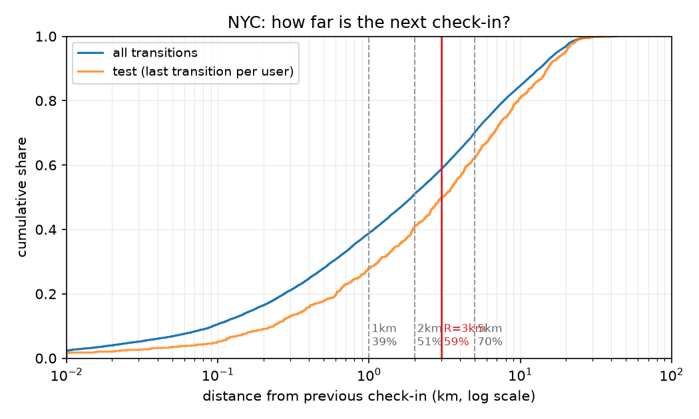
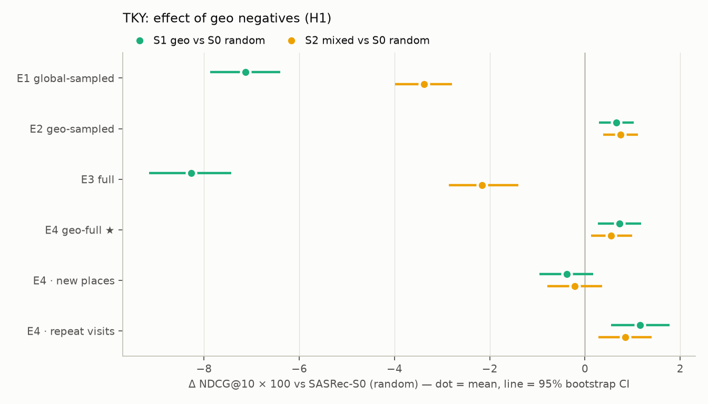
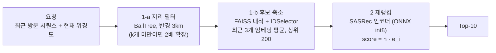

# dongne-rec

**동네 반경 제약을 반영한 순차 추천 + 경량 서빙.** Foursquare 체크인 데이터(뉴욕·도쿄)로 "지금 있는 동네에서 다음에 갈 곳"을 추천하는 문제를 작게 재현했어요. 그리고 **평가 방식, 학습 negative, 서빙 구조**가 결과를 각각 얼마나 바꾸는지 측정했어요.

## TL;DR

1. **평가 방식이 1등을 바꿔요 (H2).** SASRec 논문식 평가(전역 랜덤 후보 100개)에선 SASRec이 1등이에요. 그런데 전체 랭킹과 동네 랭킹에선 "자주 간 곳 순서"라는 단순한 베이스라인이 1등이에요. 표준 평가로 모델을 고르면 SASRec 3종 중 **동네 지표가 가장 낮은 모델**을 골라요 (두 도시 모두). 표준 평가 점수는 동네 랭킹 점수보다 3.5~4.0배 높게 나와요.
2. **동네 안에서 negative를 뽑으면 동네 랭킹이 오르지만, 이득은 재방문에서만 나와요 (H1).** 동네 랭킹 NDCG@10이 +1.7%(뉴욕, 유의하지 않음)~+3.5%(도쿄, p<0.001) 올라요. 신규 장소는 오히려 −5~−13%로 떨어져요 (유의하지 않음). 아직 안 가 본 동네 장소를 negative로 밀어내는 **false negative 효과**예요. 전체 랭킹 손실은 전역·동네 negative를 반씩 섞으면 줄어들어요.
3. **서빙은 p99 1.0ms이고, int8 양자화는 크기 −74%에 정확도 손실이 없어요.** 다만 이 규모(동네 안 후보 약 1,200개)에선 FAISS 후보 축소 단계가 손해예요. 정답이 후보에 남는 비율을 49.9%에서 34.8%로 깎는데 지연은 그대로예요. 이 단계는 동네 안 후보가 10만 개를 넘을 때 의미가 생겨요.

<p align="center"></p>

---

## 왜 이 문제인가

동네 기반 서비스에선 추천 후보가 처음부터 **이용자가 실제로 갈 수 있는 범위**로 제한돼요. 그러면 두 가지 질문이 생겨요.

- **학습:** 모델이 구분해야 하는 건 "가까운 곳 vs 먼 곳"이 아니라 "동네 안의 여러 곳 중 어디"예요. negative도 동네 안에서 뽑아야 하지 않을까요?
- **평가:** 추천 논문의 표준 평가는 정답 1개와 전역 랜덤 후보 100개를 비교해요. 랜덤 후보는 대부분 멀리 있어서 정답과 쉽게 구분돼요. 이 평가가 동네 서비스의 성능을 제대로 보여줄까요?

공개 데이터로 이 두 질문을 작게 재현했어요. 체크인한 장소를 "동네 가게·매물"로, 체크인을 "상호작용"으로 대응시켰어요.

## 데이터

[Foursquare NYC and Tokyo Check-ins](#참고) (2012-04 ~ 2013-02). 전처리 순서는 다음과 같아요.

1. 같은 장소에 연속으로 체크인한 기록을 합쳐요.
2. 유저·장소마다 체크인 5회 이상만 남겨요 (반복 k-core).
3. 장소 좌표는 체크인 좌표의 중앙값으로 정해요.

| 표 1 | 뉴욕 (주) | 도쿄 |
|---|---|---|
| 유저 / 장소 / 체크인 | 1,083 / 9,786 / 163,649 | 2,293 / 14,960 / 454,288 |
| 밀도 | 1.54% | 1.32% |
| 유저당 체크인 (median) | 103 | 131 |
| 정답이 재방문인 비율 (test) | **65.8%** | **71.9%** |
| 정답이 직전 장소 3km 안인 비율 (전체 / test) | 58.7% / 49.8% | 56.7% / 47.0% |

<p align="center"></p>

**동네 반경 R = 3km.** 반경을 키우면 정답이 동네 안에 있을 확률은 올라가요. 하지만 동네가 카탈로그 전체에 가까워져 제약이 무의미해져요. 그래서 "동네 후보가 카탈로그의 15% 이하인 반경 중 정답 포함률이 가장 높은 것"을 골랐어요. 처음 정한 규칙("정답 포함률 70%")은 5km를 골랐는데, 그때 동네 후보가 카탈로그의 34%(중앙값)~49%(상위 10%)였어요. 상세: [EDA 리포트](results/eda/NYC/eda_report.md)

## 문제 정의와 가설

유저의 체크인 시퀀스 `s_1 … s_t`가 주어지면 다음 장소 `s_{t+1}`을 Top-10으로 맞혀요. 현재 위치는 직전 장소 좌표 `loc(s_t)`이고, **동네**는 그 반경 3km 원이에요.

- **H1 (학습):** SASRec은 좌표를 입력으로 받지 않아요. 전역 랜덤 negative는 대부분 10km 넘게 떨어진 곳이라, 모델은 주로 "가까움 vs 멂"을 배워요. negative를 동네 안에서 뽑으면 동네 안 구분력이 올라갈 거예요.
- **H2 (평가):** 전역 랜덤 후보로 평가하면 성능이 부풀려지고, 모델 순위도 바뀔 거예요.

## 실험 설정

**분할:** 유저별 시간순 leave-one-out이에요 (마지막 = test, 그 앞 = valid). 인기도·유사도 통계와 모델 학습은 train 구간만 써요.

**평가 프로토콜:** "샘플링 vs 전체" × "전역 vs 동네"의 2×2예요.

| | 전역 | 동네 (반경 3km) |
|---|---|---|
| **샘플링** (정답 + negative 100) | **E1** Global-sampled — SASRec 원 논문 방식 | **E2** Geo-sampled |
| **전체 랭킹** | **E3** Full | **E4** Geo-full ★ 주 지표 |

공통 규칙은 다음과 같아요.

- **동네 프로토콜(E2·E4)에서 정답이 반경 밖이면 miss로 쳐요.** 동네 필터가 있는 서비스에선 노출될 수 없는 장소예요. 또 E2에서 이를 정답으로 인정하면 "유일하게 먼 후보 = 정답"이라는 지름길이 생겨요. 이건 1일차에 발견해서 고친 문제예요.
- 현재 장소는 후보에서 빼요. 연속 중복을 합쳤으므로 정의상 정답이 될 수 없어요.
- E1·E2의 negative는 원 논문처럼 방문 이력을 제외하고, 시드를 고정해 모든 모델이 같은 후보를 써요.
- 동점은 무작위 순서의 기댓값으로 계산해요. 인기순 모델은 동점이 많아서, 이걸 낙관적으로 처리하면 흔한 버그가 돼요.

**모델**

| 모델 | 설명 |
|---|---|
| MostPop / GeoPop | 전체 인기순 / 동네 안 인기순을 먼저 |
| PersonalFreq | 본인 방문 빈도 → 최근 방문 → 전체 인기순 |
| ItemKNN | 공동 방문 cosine 유사도, 최근 장소 가중합 (valid에서 튜닝) |
| SASRec | causal self-attention 2블록, hidden 256, 길이 100, BCE loss (valid 튜닝: hidden 64→256) |

**SASRec 학습 negative**

- **S0** 전역 랜덤 (원 논문)
- **S1** 현재 장소 반경 3km 안에서 균등
- **S2** 위치마다 반반 섞기 (α = 0.5)

샘플러만 바꾸고 나머지 설정은 같아요.

**통계:** SASRec은 시드 3개의 평균 ± 표준편차예요. 모델 간 비교는 쿼리(유저) 단위 paired bootstrap 2,000회로 95% 신뢰구간을 구해요.

## 결과

### H2: 평가 방식이 순위를 바꿔요

test NDCG@10, 뉴욕 (SASRec은 시드 3개 평균 ± 표준편차)

| 모델 | E1 Global-sampled | E2 Geo-sampled | E3 Full | E4 Geo-full ★ |
|---|---|---|---|---|
| MostPop | 0.181 | 0.086 | 0.027 | 0.044 |
| GeoPop | 0.302 | 0.099 | 0.044 | 0.044 |
| **PersonalFreq** | 0.713 | 0.371 | **0.363** | **0.239** |
| ItemKNN | 0.660 | 0.341 | 0.290 | 0.193 |
| SASRec-S0 (random) | **0.753 ± 0.004** | 0.370 ± 0.006 | 0.329 ± 0.005 | 0.217 ± 0.004 |
| SASRec-S1 (geo) | 0.703 ± 0.005 | 0.370 ± 0.004 | 0.297 ± 0.003 | 0.221 ± 0.002 |
| SASRec-S2 (mixed) | 0.729 ± 0.007 | **0.371 ± 0.000** | 0.331 ± 0.005 | 0.221 ± 0.001 |

<details>
<summary>도쿄 표</summary>

| 모델 | E1 Global-sampled | E2 Geo-sampled | E3 Full | E4 Geo-full ★ |
|---|---|---|---|---|
| MostPop | 0.371 | 0.158 | 0.059 | 0.071 |
| GeoPop | 0.417 | 0.159 | 0.071 | 0.071 |
| **PersonalFreq** | 0.796 | 0.378 | **0.372** | **0.237** |
| ItemKNN | 0.788 | 0.371 | 0.292 | 0.199 |
| SASRec-S0 (random) | **0.828 ± 0.001** | 0.376 ± 0.005 | 0.296 ± 0.002 | 0.208 ± 0.001 |
| SASRec-S1 (geo) | 0.756 ± 0.002 | 0.383 ± 0.002 | 0.213 ± 0.008 | 0.215 ± 0.002 |
| SASRec-S2 (mixed) | 0.794 ± 0.009 | **0.384 ± 0.005** | 0.274 ± 0.012 | 0.213 ± 0.003 |

HR@10과 세부 표: [뉴욕](results/summary/NYC/R3/table2.md) · [도쿄](results/summary/TKY/R3/table2.md) · 베이스라인 리포트: [뉴욕](results/baselines/NYC/R3/summary.md) · [도쿄](results/baselines/TKY/R3/summary.md)

</details>

- **1등이 바뀌어요.** E1 1등은 SASRec-S0이에요. 그런데 E3·E4 1등은 PersonalFreq이고, S0은 SASRec 3종 중 E4 꼴찌예요. E1 순위와 E4 순위의 Kendall τ는 0.59(뉴욕)·0.49(도쿄)예요.
- **부풀림은 세 군데서 와요.** E1 점수는 E4보다 3.5배(뉴욕)~4.0배(도쿄) 높아요.
  1. **이력 제외 negative:** 재방문 정답이 후보 중 유일한 "가 본 곳"이 돼서 쉽게 맞혀요. PersonalFreq는 E1 0.713, E3 0.363이에요.
  2. **반경 밖 정답:** 동네 프로토콜에선 test 정답의 절반이 miss예요.
  3. **negative의 지리적 난이도:** 정답이 동네 안인 쿼리만 보면, 위치를 안 쓰는 모델은 E1 ≈ E2예요 (비율 0.95~1.03). 위치를 직접 쓰는 GeoPop은 2.2~2.7배, 공동 방문으로 위치를 간접적으로 배운 SASRec-S0은 1.05~1.11배예요.

### H1: 동네 negative는 동네 랭킹을 올려요 — 단, 재방문에서

S0 대비 NDCG@10 변화. 쿼리 단위 paired bootstrap, 95% 신뢰구간, ✱ p < 0.05.

| | E1 Global-sampled | E3 Full | **E4 Geo-full ★** | E4 · 재방문 | E4 · 신규 |
|---|---|---|---|---|---|
| 뉴욕 S1 geo | −6.7% ✱ | −9.7% ✱ | +1.7% [−0.8, +4.3] | +2.2% | −13.0% |
| 뉴욕 S2 mixed | −3.2% ✱ | +0.7% | +1.9% [−0.3, +4.2] | +2.2% | −8.9% |
| 도쿄 S1 geo | −8.6% ✱ | −28.0% ✱ | **+3.5% [+1.3, +5.7] ✱** | **+4.2% ✱** | −9.2% |
| 도쿄 S2 mixed | −4.1% ✱ | −7.3% ✱ | **+2.6% [+0.6, +4.8] ✱** | **+3.1% ✱** | −5.3% |

<p align="center"></p>

- **H1은 일부만 지지돼요.** 동네 랭킹(E4)은 두 도시 모두 올라요. 하지만 통계적으로 유의한 건 도쿄뿐이에요.
- **거리 단서를 지워요.** 실제 다음 장소는 학습 위치 기준 중앙 1.9km 거리에 있어요. 전역 negative는 중앙 10~11km라, 거리만으로도 정답과 구분돼요. 동네 negative는 중앙 1.9km라 거리 단서가 사라져요.
- **이득은 재방문에서 나오고, 신규 장소는 오히려 떨어져요.** 처음 예상과 반대예요. 동네 negative는 "가까운 곳 중 이 유저가 실제로 가는 곳"(생활 루틴)을 구분하게 만들어요. 반면 아직 안 가 본 동네 장소, 즉 신규 정답이 나올 바로 그 후보들을 negative로 밀어내요.
- **반반 섞기(S2)가 실용적이에요.** 뉴욕에선 전체 랭킹 손실 없이 동네 랭킹 이득을 거의 그대로 가져가요. 그래서 서빙 모델로 S2를 골랐어요.

### 재방문 vs 신규: 누가 무엇을 잘하나

| E4 NDCG@10 | 뉴욕 재방문 | 뉴욕 신규 | 도쿄 재방문 | 도쿄 신규 |
|---|---|---|---|---|
| PersonalFreq | **0.356** | 0.012 | **0.326** | 0.010 |
| GeoPop | 0.055 | **0.023** | 0.088 | 0.028 |
| SASRec-S0 | 0.320 | 0.019 | 0.273 | **0.041** |
| SASRec-S2 | 0.327 | 0.018 | 0.281 | 0.039 |

재방문은 PersonalFreq가 압도적이에요 (SASRec 3종이 PersonalFreq보다 8~17% 낮고, 모두 p<0.001). 반대로 신규 장소는 데이터가 더 많은 도쿄에서 SASRec이 PersonalFreq의 약 4배예요. 당근 매물처럼 같은 물건을 다시 사지 않는 서비스라면, **신규 구간이 더 실제 문제에 가까워요.** "재방문은 개인 빈도, 신규는 SASRec"으로 나누는 혼합 모델이 자연스러운 다음 실험이에요.

## 경량 서빙



뉴욕 S2 모델, test 요청 1,083건, batch 1, 프로세스 내 측정 (Apple Silicon MacBook)

| 인코더 | 인코더 크기 | Stage 2 p50 / p99 | 전체 p50 / p99 | NDCG@10 |
|---|---|---|---|---|
| PyTorch CPU, 1스레드 | 13.3MB | 0.69 / 1.18ms | 0.90 / 1.83ms | 0.2182 |
| PyTorch MPS (GPU) | 13.3MB | 1.02 / 1.53ms | 1.26 / 2.20ms | 0.2182 |
| ONNX fp32 | 13.4MB | 0.49 / 0.67ms | 0.77 / 1.22ms | 0.2182 |
| **ONNX int8** | **3.5MB** | **0.47 / 0.53ms** | **0.73 / 1.01ms** | **0.2186** |

| 파이프라인 구성 | 재랭킹 후보 | 정답이 후보에 남은 비율 | 전체 p50 | NDCG@10 |
|---|---|---|---|---|
| 지리 필터 → FAISS 200개 → 재랭킹 | 200 | 34.8% | 1.05ms | 0.2182 |
| 지리 필터 → 동네 전체 재랭킹 | 1,208 | 49.9% | 0.99ms | 0.2218 |
| 지리 필터 없음 (전체 카탈로그) | 9,785 | 100% | 1.78ms | 0.3322 = 오프라인 E3 |

- **서빙과 오프라인 평가가 일치해요.** 전체 카탈로그 재랭킹 점수가 오프라인 E3과 정확히 같아요.
- **int8 양자화:** 크기 −74%, 정확도 손실 없음, 속도 +4%. 모델이 작아서(hidden 256, 2블록) 실행 시 양자화 비용이 연산 절약분과 비슷해요. batch 1에선 MPS(GPU)가 디스패치 오버헤드 때문에 CPU보다 느려요.
- **FAISS 후보 축소는 이 규모에선 손해예요.** 도달 가능한 정답의 30%를 잃는데 지연은 같아요. 합성 임베딩으로 재보니 후보 전체 점수 계산이 10만 개에서 0.84ms, 100만 개에서 12.6ms였어요. FAISS IVF 상위 200은 100만 개에서도 0.16ms예요. 동네 안 후보가 10만 개 이상인 서비스라면 이 단계가 필요해요. 그때는 쿼리를 미리 계산해 둔 유저 벡터로 바꾸는 게 첫 번째 개선점이에요.
- **macOS에서 PyTorch와 FAISS를 한 프로세스에 올리면 OpenMP 런타임이 충돌해요** (segfault). 서빙 경로(ONNX Runtime + FAISS)는 torch를 import하지 않도록 분리했어요.

상세: [서빙 벤치](results/serving/NYC/R3/mixed_s0/bench.md) — 후보 수 N에 따른 trade-off와 카탈로그 확장 비용 표 포함

## 한계

- **데이터:** 2012~13년 체크인이고 유저가 1~2천 명이에요. 체크인은 거래가 아니고, 재방문 비율(66~72%)도 중고 거래와 매우 달라요.
- **분할:** leave-one-out은 유저 간 전역 시간축을 지키지 않아요 (다른 유저의 "미래"가 학습에 들어가요). 또 유저별 마지막 체크인이라 test 정답이 전체 이동보다 멀어요 (중앙 3.1km vs 1.9km).
- **위치 근사:** 현재 위치 = 직전 체크인 장소예요. 직전 체크인이 하루 넘게 지난 요청이 뉴욕 test의 58%이고, 이 구간에선 위치 신호가 약해요.
- **평가:**
  - 뉴욕은 test 쿼리의 22%가 반경 안 후보 100개를 못 채워, 반경 밖 가까운 장소로 E2 후보를 채워요.
  - 신뢰구간은 쿼리 표본 변동만 반영해요 (시드 변동은 표의 ± 표준편차로 따로 보고).
- **튜닝:** 하이퍼파라미터는 뉴욕 valid에서 seed 1개로 정했고, 도쿄에도 같은 설정을 썼어요. 반경 민감도(2km·5km)와 혼합 비율 α 스윕은 하지 않았어요.
- **서빙:** 노트북에서 프로세스 내 측정이에요. 네트워크를 거친 부하 테스트와 동시 요청 처리량은 재지 않았어요.

## 실서비스라면: 온라인 A/B 설계

오프라인 E4 개선이 실제 가치로 이어지는지는 온라인 실험으로만 확인할 수 있어요. 이 프로젝트 결과를 반영하면 이렇게 설계하겠어요.

- **가설:** 동네 negative를 섞어 학습한 모델(S2)이 동네 추천 지면의 관련성을 높여 전환을 늘린다.
- **1차 지표:** 추천 지면 노출 대비 클릭 → 채팅 시작(거래 의도) 전환율, 유저 단위 집계.
- **가드레일:**
  - **신규 매물 노출 비중과 그 클릭률.** H1에서 동네 negative가 신규 장소 성능을 낮췄기 때문에, 이 실험에서 가장 먼저 깨질 수 있는 지표예요.
  - 판매자 측 노출 집중도(Gini), 숨김·신고율, p99 latency.
- **랜덤화 단위:**
  - 기본은 유저 단위예요.
  - 다만 같은 동네의 구매자들이 같은 매물을 두고 경쟁하는 양면 마켓이라, 처치군의 행동이 대조군 노출에 영향을 줄 수 있어요 (간섭).
  - 효과가 크면 지역(동네 클러스터) 단위 랜덤화로 교차 검증해요.
- **기간·검정력:** 요일 효과를 덮도록 최소 2주로 잡고, 사전에 최소 검출 효과(MDE)와 표본 수를 계산해요. 첫 주는 novelty 효과를 따로 봐요.
- **오프라인-온라인 정합성:** 온라인 지표와 같은 방향으로 움직이는 게 E1인지 E4인지 확인하는 것 자체가 H2의 실전 검증이에요. 이 프로젝트에선 둘이 반대 모델을 골랐어요.

## 다음 단계

- 재방문은 PersonalFreq, 신규는 SASRec으로 나누는 혼합 모델
- 서빙 후보 축소 쿼리를 "최근 임베딩 평균"에서 미리 계산한 유저 벡터로
- 거리·위치를 모델 입력(feature)으로 넣어 hard filter와 비교
- 동네 negative의 false negative 완화: 방문 확률이 높은 미방문 장소를 negative에서 덜 뽑기
- 장소 카테고리 텍스트 임베딩으로 신규(cold-start) 장소 초기화

## 재현 방법

```bash
make setup                         # .venv + 의존성 (Python 3.12, Apple Silicon에서 확인)
# Kaggle "Foursquare NYC and Tokyo Check-ins"의 CSV 2개를 data/raw/에
make data eda geo CITY=NYC         # 전처리 → EDA 리포트 → 반경 3km 이웃 인덱스
make baselines CITY=NYC            # 베이스라인 4종 × E1~E4
for s in random geo mixed; do for seed in 0 1 2; do make train CITY=NYC SAMPLER=$s SEED=$seed; done; done
make compare CITY=NYC              # 표·그림·bootstrap → results/summary/NYC/R3/
make export bench CITY=NYC         # ONNX fp32/int8 → 서빙 벤치
make serve                         # FastAPI :8000, POST /recommend
make test                          # 47개 테스트
```

학습은 MPS에서 뉴욕 1회 35~55초, 도쿄 1회 1~3분이에요. 모든 결과는 `results/` 아래에 config와 함께 저장돼요. 체크포인트(`*.pt`)와 서빙 아티팩트(`artifacts/`)는 git에서 제외했어요.

<details>
<summary>프로젝트 구조</summary>

```
configs/            data.yaml (도시, k-core, 반경) · eval.yaml · sasrec.yaml · serving.yaml
src/dongne_rec/
  data/             preprocess.py · geo.py (haversine, 반경 이웃) · split.py · sequences.py
  analysis/         eda.py
  baselines/        pop.py (MostPop, GeoPop, PersonalFreq) · itemknn.py · run.py
  models/           sasrec.py
  train/            samplers.py (S0·S1·S2) · trainer.py
  eval/             protocols.py (E1~E4) · metrics.py · stats.py (bootstrap) · compare.py · figures.py
  serving/          export_onnx.py · pipeline.py (2단계) · bench.py · api.py
tests/              분할 누출, 지표 동점, 프로토콜 규칙, 샘플러, ONNX 변환, API 등 47개
results/            eda · baselines · sasrec · summary · serving · tuning
PROJECT_SPEC.md     설계 결정과 날짜별 진행 기록
```

</details>

## 참고

- Dingqi Yang, Daqing Zhang, Vincent W. Zheng, Zhiyong Yu. *Modeling User Activity Preference by Leveraging User Spatial Temporal Characteristics in LBSNs.* IEEE TSMC, 2015. — 데이터셋 (비상업 연구용)
- Wang-Cheng Kang, Julian McAuley. *Self-Attentive Sequential Recommendation.* ICDM, 2018.
- Walid Krichene, Steffen Rendle. *On Sampled Metrics for Item Recommendation.* KDD, 2020.
