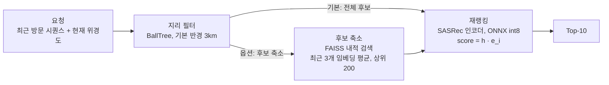

# dongne-rec

동네 반경 안에서 다음 방문 장소를 추천하는 순차 추천 프로젝트입니다. Foursquare 뉴욕·도쿄 체크인 데이터를 사용해, 추천 후보의 범위와 학습 시 negative 샘플링 방식이 결과에 어떤 영향을 주는지 비교했습니다. 학습한 모델은 ONNX로 변환하고 FastAPI로 연결해 서빙 비용도 측정했습니다.

## 주요 결과

1. **이용자별 leave-one-out에서는 평가 방식에 따라 1위가 바뀌었습니다.** 전역에서 뽑은 negative 100개와 정답을 비교하는 E1에서는 SASRec이, 전체 후보를 평가하는 E3와 동네 후보를 평가하는 E4에서는 PersonalFreq가 두 도시에서 가장 높았습니다.
2. **동네 negative의 효과는 도시와 분할에 따라 달랐습니다.** 3km leave-one-out에서 동네 샘플링의 E4 NDCG@10은 전역 샘플링 대비 뉴욕 +1.7%, 도쿄 +3.5%였고 도쿄의 신뢰구간만 0을 넘었습니다. 전역 시간 분할에서도 도쿄의 혼합 샘플링은 개선됐으며, 뉴욕의 전체 E4 개선은 확인되지 않았습니다.
3. **고정 반경에서 동네 전체를 재랭킹한 FP32 결과는 오프라인 E4와 일치했습니다.** 같은 정책에서 ONNX int8 인코더 파일은 fp32 대비 약 74% 작았고, 프로세스 내 p99는 1.23ms였습니다. 초기 실험에서는 FAISS로 후보를 줄이면서 정답 보존율이 떨어졌습니다.

<p align="center"></p>

## 문제와 접근

동네 기반 추천에서는 이용자가 실제로 갈 수 있는 범위가 후보 선택의 기준이 됩니다. 멀리 있는 장소와 가까운 장소를 구분하는 것만으로는, 같은 동네 안에서 어디를 추천할지 결정하기 어렵습니다.

이 프로젝트에서는 두 가지를 확인했습니다.

- **학습 후보의 범위:** negative를 동네 안에서 뽑으면 가까운 장소 사이의 구분력이 좋아지는가?
- **평가 후보의 범위:** 전역 랜덤 후보로 얻은 성능과 모델 순위가 동네 추천에서도 유지되는가?

negative는 학습이나 평가에서 정답과 비교하는 다른 장소를 뜻합니다. 체크인을 이용자와 장소 사이의 상호작용으로 보고 실험했으며, 중고 거래에 적용할 때 생기는 차이는 [한계](#한계)에 정리했습니다.

## 데이터

Foursquare NYC and Tokyo Check-ins 데이터의 2012년 4월~2013년 2월 기록을 사용했습니다. 데이터 출처는 [참고](#참고)에 적었습니다.

전처리에서는 같은 장소에 연속으로 체크인한 기록을 합친 뒤, 이용자와 장소별 체크인이 각각 5회 이상 남도록 k-core 필터를 반복 적용했습니다. 필터링 후 다시 생긴 연속 중복도 제거했습니다. 장소 좌표는 원본 체크인 좌표의 중앙값을 사용했습니다.

| 항목 | 뉴욕 (NYC) | 도쿄 (TKY) |
|---|---|---|
| 이용자 / 장소 / 체크인 | 1,083 / 9,786 / 163,649 | 2,293 / 14,960 / 454,288 |
| 밀도 | 1.54% | 1.32% |
| 이용자당 체크인 중앙값 | 103 | 131 |
| test 정답이 재방문인 비율 | 65.8% | 71.9% |
| 다음 장소가 직전 장소의 3km 안인 비율 (전체 / test) | 58.7% / 49.8% | 56.7% / 47.0% |

<p align="center"></p>

동네 반경은 **3km**로 정했습니다. 반경을 넓히면 정답 포함률은 올라가지만, 후보가 전체 카탈로그에 가까워져 동네 제약의 의미가 약해집니다. 이를 고려해 후보 수의 중앙값이 카탈로그의 15% 이하인 반경 중 정답 포함률이 가장 높은 값을 선택했습니다. 처음 검토한 5km에서는 뉴욕의 후보 비중이 중앙값 34%, 상위 10% 지점에서 49%였습니다.

반경 선택 과정과 분포는 [뉴욕 EDA](results/eda/NYC/eda_report.md)와 [도쿄 EDA](results/eda/TKY/eda_report.md)에서 확인할 수 있습니다.

## 문제 정의와 가설

방문 시퀀스 `s_1 … s_t`를 입력받아 다음 장소 `s_{t+1}`을 Top-10으로 추천합니다. 현재 위치는 직전 장소의 좌표 `loc(s_t)`로 근사하고, 그 위치에서 반경 3km 안을 동네로 정의했습니다.

- **H1 — 학습:** 동네 안에서 negative를 뽑으면 동네 후보 전체를 비교하는 E4 성능이 좋아질 것이다. SASRec은 좌표를 직접 입력받지 않지만, 방문 패턴을 통해 지리적 관계를 간접적으로 학습할 수 있다는 가정에서 출발했습니다.
- **H2 — 평가:** 전역 랜덤 후보를 쓰는 평가와 동네 전체 후보를 쓰는 평가 사이에 점수 차이와 모델 순위 변화가 나타날 것이다.

## 실험 설정

이용자별 시간순 leave-one-out 분할을 사용했습니다. 마지막 체크인은 test, 그 앞은 valid, 나머지는 train입니다. 인기도·유사도 통계와 모델 학습에는 train만 사용하고, test 시점에는 valid 정답을 입력 이력에 포함합니다.

### 평가 프로토콜

| 후보 구성 | 전역 | 동네 (반경 3km) |
|---|---|---|
| 정답 + negative 100개 | E1 Global-sampled | E2 Geo-sampled |
| 후보 전체 랭킹 | E3 Full | **E4 Geo-full — 주 지표** |

- E2와 E4에서 정답이 반경 밖에 있으면 miss로 처리합니다. 따라서 두 지표에는 동네 안에서의 순위뿐 아니라 반경의 정답 포함률도 반영됩니다.
- 현재 장소는 모든 후보군에서 제외합니다. 연속 중복을 제거했으므로 다음 정답이 될 수 없습니다.
- E1·E2의 negative에서는 방문 이력을 제외합니다. 후보는 시드를 고정해 생성하고 모든 모델에 동일하게 사용합니다. E2에서 반경 안 후보가 부족하면 반경 밖의 가까운 장소로 채웁니다.
- E3·E4는 현재 장소를 제외한 과거 방문 장소도 후보에 포함합니다.
- 동점은 무작위 순서로 정렬했을 때의 지표 기댓값으로 계산합니다.

### 비교 모델과 학습 설정

| 모델 | 설명 |
|---|---|
| MostPop / GeoPop | 전체 인기순 / 동네 안 장소를 우선하는 인기순 |
| PersonalFreq | 개인 방문 빈도 → 최근 방문 → 전체 인기순 |
| ItemKNN | 공동 방문 cosine 유사도와 최근 장소의 가중합. valid에서 설정 선택 |
| SASRec | causal self-attention 2블록, hidden 256, 최대 길이 100, dropout 0.3, BCE loss |

SASRec은 다음 세 가지 negative 샘플링을 비교했습니다. 모델과 나머지 학습 설정은 동일합니다.

| 구분 | 방식 |
|---|---|
| S0 `random` | 전체 장소에서 균등 추출 |
| S1 `geo` | 현재 장소의 반경 3km 안에서 균등 추출. 이력·정답과 충돌하는 후보는 재추출하고, 남은 충돌은 전역 샘플링으로 대체 |
| S2 `mixed` | 학습 위치마다 확률 α = 0.5로 geo 또는 random 선택 |

SASRec은 시드 0·1·2의 평균 ± 표준편차를 보고했습니다. 모델 간 차이는 쿼리(이용자) 단위 paired bootstrap 2,000회로 95% 신뢰구간을 구했습니다. 이 신뢰구간은 쿼리 표본의 변동을 나타내며, 학습 시드의 불확실성까지 합친 값은 아닙니다.

## 결과

### H2: 평가 방식에 따라 모델 순위가 달라졌습니다

뉴욕 test NDCG@10입니다. SASRec은 시드 3개의 평균 ± 표준편차입니다.

| 모델 | E1 Global-sampled | E2 Geo-sampled | E3 Full | E4 Geo-full |
|---|---|---|---|---|
| MostPop | 0.181 | 0.086 | 0.027 | 0.044 |
| GeoPop | 0.302 | 0.099 | 0.044 | 0.044 |
| **PersonalFreq** | 0.713 | 0.371 | **0.363** | **0.239** |
| ItemKNN | 0.660 | 0.341 | 0.290 | 0.193 |
| SASRec-S0 (random) | **0.753 ± 0.004** | 0.370 ± 0.006 | 0.329 ± 0.005 | 0.217 ± 0.004 |
| SASRec-S1 (geo) | 0.703 ± 0.005 | 0.370 ± 0.004 | 0.297 ± 0.003 | 0.221 ± 0.002 |
| SASRec-S2 (mixed) | 0.729 ± 0.007 | **0.371 ± 0.000** | 0.331 ± 0.005 | 0.221 ± 0.001 |

<details>
<summary>도쿄 결과</summary>

| 모델 | E1 Global-sampled | E2 Geo-sampled | E3 Full | E4 Geo-full |
|---|---|---|---|---|
| MostPop | 0.371 | 0.158 | 0.059 | 0.071 |
| GeoPop | 0.417 | 0.159 | 0.071 | 0.071 |
| **PersonalFreq** | 0.796 | 0.378 | **0.372** | **0.237** |
| ItemKNN | 0.788 | 0.371 | 0.292 | 0.199 |
| SASRec-S0 (random) | **0.828 ± 0.001** | 0.376 ± 0.005 | 0.296 ± 0.002 | 0.208 ± 0.001 |
| SASRec-S1 (geo) | 0.756 ± 0.002 | 0.383 ± 0.002 | 0.213 ± 0.008 | 0.215 ± 0.002 |
| SASRec-S2 (mixed) | 0.794 ± 0.009 | **0.384 ± 0.005** | 0.274 ± 0.012 | 0.213 ± 0.003 |

</details>

E1에서는 SASRec-S0이 가장 높지만, E3와 E4에서는 PersonalFreq가 앞섭니다. SASRec 세 종류만 비교해도 E1에서 가장 높았던 S0이 E4에서는 가장 낮습니다. E1과 E4 순위의 Kendall τ는 뉴욕 0.59, 도쿄 0.49였습니다.

SASRec-S0의 E1 점수는 E4의 약 3.5배(뉴욕), 4.0배(도쿄)입니다. 다만 이 비율을 후보 샘플링만의 효과로 해석할 수는 없습니다. 다음 조건이 함께 달라지기 때문입니다.

- **방문 이력 제외:** E1에서는 재방문 정답이 후보 중 유일한 방문 장소가 될 수 있습니다. PersonalFreq의 뉴욕 점수도 E1 0.713, E3 0.363으로 차이가 큽니다.
- **반경 밖 정답 처리:** 동네 프로토콜에서는 test 정답의 약 절반이 추천 범위 밖이어서 miss가 됩니다.
- **후보의 지리적 난이도:** 정답이 동네 안인 쿼리만 비교하면 위치를 직접 쓰지 않는 베이스라인의 E1/E2 비율은 0.95~1.03입니다. GeoPop은 2.2~2.7배, SASRec-S0은 1.05~1.11배였습니다.

HR@10과 구간별 결과는 [뉴욕 비교 리포트](results/summary/NYC/R3/table2.md)와 [도쿄 비교 리포트](results/summary/TKY/R3/table2.md)에 정리했습니다. 베이스라인 상세 결과는 [뉴욕](results/baselines/NYC/R3/summary.md)·[도쿄](results/baselines/TKY/R3/summary.md) 리포트를 참고하면 됩니다.

### H1: 동네 negative의 개선은 재방문에서 나타났습니다

S0 대비 NDCG@10의 상대 변화입니다. 대괄호는 상대 변화의 95% 신뢰구간이며, ✱는 p < 0.05를 뜻합니다.

| 설정 | E1 Global-sampled | E3 Full | **E4 Geo-full** | E4 재방문 | E4 신규 |
|---|---|---|---|---|---|
| 뉴욕 S1 geo | −6.7% ✱ | −9.7% ✱ | +1.7% [−0.8, +4.3] | +2.2% | −13.0% |
| 뉴욕 S2 mixed | −3.2% ✱ | +0.7% | +1.9% [−0.3, +4.2] | +2.2% | −8.9% |
| 도쿄 S1 geo | −8.6% ✱ | −28.0% ✱ | **+3.5% [+1.3, +5.7] ✱** | **+4.2% ✱** | −9.2% |
| 도쿄 S2 mixed | −4.1% ✱ | −7.3% ✱ | **+2.6% [+0.6, +4.8] ✱** | **+3.1% ✱** | −5.3% |

<p align="center"></p>

H1은 일부 조건에서 지지됐습니다. E4는 두 도시 모두 높아졌지만, 유의한 개선은 도쿄에서만 확인했습니다. geo와 random을 반씩 섞은 S2는 S1보다 전체 랭킹(E3)의 손실을 줄였습니다. 뉴욕에서는 E3 손실 없이 E4 개선 폭이 비슷해, 서빙 실험에는 S2를 사용했습니다.

샘플러 진단에서 실제 다음 장소와 geo negative의 거리는 모두 중앙값 약 1.9km였고, random negative는 약 10~11km였습니다. 동네 샘플링이 후보의 거리 분포를 정답과 가깝게 만든 것은 확인할 수 있습니다.

신규 장소 점수가 낮아진 이유로는 **앞으로 방문할 수 있는 미방문 장소를 negative로 학습하는 false negative 문제**를 생각할 수 있습니다. 다만 현재 실험은 이 원인을 분리해 검증하지 않았고, 신규 구간의 하락도 통계적으로 유의하지 않습니다. 후속 실험에서 확인할 가설로 남겨 두었습니다.

### 재방문과 신규 장소의 차이

여기서 신규는 **해당 이용자의 입력 이력에 없는 장소**를 뜻합니다. 학습 데이터에 전혀 없던 장소를 추천하는 cold-start와는 구분합니다.

| E4 NDCG@10 | 뉴욕 재방문 | 뉴욕 신규 | 도쿄 재방문 | 도쿄 신규 |
|---|---|---|---|---|
| PersonalFreq | **0.356** | 0.012 | **0.326** | 0.010 |
| GeoPop | 0.055 | **0.023** | 0.088 | 0.028 |
| SASRec-S0 | 0.320 | 0.019 | 0.273 | **0.041** |
| SASRec-S2 | 0.327 | 0.018 | 0.281 | 0.039 |

재방문에서는 PersonalFreq가 가장 높았습니다. SASRec은 PersonalFreq보다 8~17% 낮았고, 이 차이는 모두 p < 0.001이었습니다. 신규 장소에서는 도쿄의 SASRec이 PersonalFreq보다 약 4배 높았습니다. 뉴욕에서는 GeoPop이 SASRec보다 높아 도시별 차이도 있었습니다.

이 차이를 바탕으로 방문 후보와 미방문 후보에 서로 다른 가중치를 적용했습니다. 요청 시점의 이력만 사용해 전체 후보를 정렬하고, 정답의 방문 여부는 사후 평가에 사용했습니다. [방문 이력 기반 순위 결합](#방문-이력-기반-순위-결합)

## 경량 서빙

기본 파이프라인은 고정 반경 안의 전체 후보를 SASRec으로 재랭킹합니다. 반경 확장과 FAISS 후보 축소는 설정에서 선택합니다.



아래 두 표는 뉴욕 S2 seed 0 모델과 test 요청 1,083건을 사용한 초기 실험입니다. 첫 표는 후보를 200개로 줄이는 구성의 결과입니다. 지연은 Apple Silicon MacBook에서 batch 1로 측정한 프로세스 내부 시간입니다.

| 인코더 | 인코더 크기 | Stage 2 p50 / p99 | 전체 p50 / p99 | NDCG@10 |
|---|---|---|---|---|
| PyTorch CPU, 1스레드 | 13.3MB | 0.69 / 1.18ms | 0.90 / 1.83ms | 0.2182 |
| PyTorch MPS | 13.3MB | 1.02 / 1.53ms | 1.26 / 2.20ms | 0.2182 |
| ONNX fp32 | 13.4MB | 0.49 / 0.67ms | 0.77 / 1.22ms | 0.2182 |
| **ONNX int8** | **3.5MB** | **0.47 / 0.53ms** | **0.73 / 1.01ms** | **0.2186** |

ONNX 행은 라이브러리 기본 스레드 설정입니다. 약 74% 감소는 인코더 파일 기준이며, 모든 구성은 별도로 약 10.0MB의 fp32 아이템 임베딩을 사용합니다. int8의 Stage 2 p50 개선은 약 4%로, 이 실험에서는 속도보다 인코더 크기 감소가 더 큰 이점이었습니다.

후보 축소 여부는 ONNX fp32, 단일 스레드로 따로 비교했습니다.

| 파이프라인 구성 | 재랭킹 후보 중앙값 | 정답이 후보에 남은 비율 | 전체 p50 | NDCG@10 |
|---|---|---|---|---|
| 지리 필터 → FAISS 200개 → 재랭킹 | 200 | 34.8% | 1.05ms | 0.2182 |
| 지리 필터 → 동네 전체 재랭킹 | 1,208 | 49.9% | 0.99ms | 0.2218 |
| 전체 카탈로그 재랭킹 | 9,785 | 100% | 1.78ms | 0.3322 |

전체 카탈로그 재랭킹은 같은 체크포인트의 오프라인 E3(0.3322)와 일치했습니다. 동네 전체 재랭킹은 오프라인 E4(0.2209)보다 0.0009 높았습니다. 후보가 부족할 때 반경을 넓히는 서빙 정책 때문에 평가 후보가 일부 달라집니다.

초기 실험에서 FAISS로 200개를 남기면 정답 보존율이 49.9%에서 34.8%로 떨어졌고 전체 지연은 비슷했습니다. 이 결과를 바탕으로 동네 전체 재랭킹을 기본 경로로 설정했습니다.

합성 임베딩 벤치에서는 전체 점수 계산이 후보 10만 개에서 0.84ms, 100만 개에서 12.64ms였고, FAISS IVF 상위 200개 검색은 100만 개에서 0.16ms였습니다. 이는 후보 축소를 다시 검토할 근거이지만, 특정 후보 수가 항상 전환 기준이 된다는 뜻은 아닙니다. 현재 서비스 경로의 `IndexFlatIP`와 합성 벤치의 IVF도 서로 다른 검색 방식입니다.

macOS 실험 환경에서는 PyTorch와 FAISS의 OpenMP 런타임 충돌이 발생해, ONNX 서빙 경로에서 torch를 import하지 않도록 분리했습니다. 구성별 측정 조건과 후보 수에 따른 결과는 [서빙 벤치 리포트](results/serving/NYC/R3/mixed_s0/bench.md)에 있습니다.

### 고정 반경과 반경 확장 검증

같은 뉴욕 3km 체크포인트와 test 요청 1,083건으로 동네 전체 재랭킹을 다시 측정했습니다. 벤치는 오프라인 E4와 같은 동점 순위의 기댓값을 사용합니다. 실제 반환 순위로 계산한 지표도 JSON에 별도로 저장합니다.

| 반경 모드 | 인코더 | 확장 요청 | 최대 검색 반경 | NDCG@10 | HR@10 |
|---|---|---:|---:|---:|---:|
| 고정 | ONNX fp32 | 0 | 3km | 0.2209 | 0.3112 |
| 고정 | ONNX int8 | 0 | 3km | 0.2210 | 0.3102 |
| 확장 | ONNX fp32 | 3 | 12km | 0.2218 | 0.3121 |
| 확장 | ONNX int8 | 3 | 12km | 0.2219 | 0.3112 |

고정 반경 FP32의 NDCG@10과 HR@10은 오프라인 E4와 일치했습니다. 인코더 파일은 fp32 13.4MB, int8 3.5MB입니다. 같은 고정 반경 정책에서 PyTorch MPS도 실행했고, batch 1의 프로세스 내 p50은 1.35ms, p99는 2.07ms였습니다. [기본 정책 검증 리포트](results/serving/NYC/R3/mixed_s0/bench-20261109T101321387285Z-b3f6664b6034/bench.md)

### 실제 HTTP 부하 측정

NYC 고정 3km, SASRec-S2 seed 0의 ONNX int8 모델을 Apple M4 Pro(논리 코어 12개, RAM 24GiB)에서 측정했습니다. Uvicorn 워커 1개와 ONNX Runtime의 기본 intra-op 스레드 설정을 사용했습니다. 각 회차에서 새 서버에 valid 요청 200건으로 워밍업한 뒤 같은 test 요청 1,000건을 보냈습니다. 두 정책과 세 동시성에서 각각 3회씩, 총 18,000건을 측정했습니다.

| 동시성 | 후보 정책 | 추천 내부 p50 / p95 / p99 (ms) | HTTP p50 / p95 / p99 (ms) | 성공 건/초 | 오류율 | 서버 CPU | 서버 최대 RSS (MiB) |
|---:|---|---:|---:|---:|---:|---:|---:|
| 1 | 동네 전체 | 0.82 / 1.31 / 1.76 | 2.03 / 3.19 / 6.54 | 447.8 | 0.00% | 553.6% | 325.1 |
| 1 | FAISS 200 | 0.83 / 1.10 / 1.36 | 1.98 / 2.76 / 5.71 | 474.8 | 0.00% | 554.2% | 281.5 |
| 4 | 동네 전체 | 1.17 / 1.87 / 2.16 | 3.69 / 5.50 / 8.51 | 1,022.7 | 0.00% | 667.4% | 345.8 |
| 4 | FAISS 200 | 1.31 / 2.08 / 2.59 | 3.88 / 6.03 / 8.35 | 973.3 | 0.00% | 665.0% | 288.3 |
| 16 | 동네 전체 | 1.00 / 1.64 / 2.10 | 13.66 / 112.13 / 194.88 | 548.7 | 0.00% | 580.6% | 346.8 |
| 16 | FAISS 200 | 0.94 / 1.45 / 1.82 | 12.58 / 113.80 / 226.43 | 568.7 | 0.00% | 578.3% | 293.4 |

추천 내부 시간은 API 응답의 `debug.latency_ms.total`로, 반경 검색부터 후보 축소와 재랭킹까지입니다. HTTP 시간은 같은 호스트의 루프백 HTTP/1.1에서 클라이언트가 요청을 보내기 시작해 응답 JSON을 파싱하고 확인하기까지입니다. 외부망과 TLS 비용은 측정 범위 밖입니다. 백분위수는 조건별 성공 요청 3,000건을 합쳐 계산했고, 처리량은 성공 건수를 측정 시간 합으로 나눴습니다. 서버 CPU 100%는 논리 코어 하나를 뜻하며, RSS는 100ms 간격과 회차의 양 끝에서 관측한 최댓값입니다.

FAISS는 요청의 70.2%에서 후보를 줄였습니다. 후보 중앙값은 1,278.5개에서 200개로, 관측 최대 RSS는 동시성별로 약 44~58MiB 줄었습니다. 두 정책 모두 동시성 4에서 처리량이 가장 높았고, 이때 전체 재랭킹이 초당 약 49건 앞섰습니다. 동시성 16에서는 두 정책의 추천 내부 p99가 2.10ms 이내였지만 HTTP p99는 각각 194.88ms와 226.43ms였습니다. [HTTP 리포트](results/serving/NYC/R3/mixed_s0/http-20261109T120102207482Z-0d8401ca6914/http.md) · [회차별 결과와 환경](results/serving/NYC/R3/mixed_s0/http-20261109T120102207482Z-0d8401ca6914/http.json)

### HTTPS 웹 데모

미드타운·이스트 빌리지·윌리엄스버그의 합성 방문 시나리오에서 반경 2·3·5km와 두 후보 정책을 바꿔 볼 수 있습니다. 화면은 실제 `/recommend`로 미리 계산한 상위 10개, 검색한 후보 수, 두 정책의 추천 중복과 거리 도식을 보여줍니다. Cloudflare Pages 무료 플랜에 공개 배포해 로그인 없이 열 수 있습니다. [공개 HTTPS 데모](https://dongne-rec-lab.pages.dev/) · [웹 데모 소스](web/demo/dist/)

## 반경·혼합 비율·전역 시간 분할 재검증

시드 0·1·2로 MPS 학습 66회를 실행하고, 초기 3km 체크포인트 18개도 MPS에서 다시 평가했습니다. 초기와 재평가의 NDCG@10은 일치했습니다. [전체 실험 리포트와 그래프](results/reports/sensitivity/stage3-20261109T112330626325Z-6fd4b60917f0/report.md)

- **반경 2·3·5km:** 두 도시에서 PersonalFreq와 SASRec 세 변형의 전체 E4는 5km에서 가장 높았습니다. 2km에서 5km로 넓힐 때 정답 포함률은 뉴욕 40.8% → 62.2%, 도쿄 41.2% → 58.8%였고, 후보 중앙값은 각각 438 → 3,290개, 581 → 3,372개로 늘었습니다. 이 모델들은 각 반경에서 정답이 포함된 요청만 집계하면 반경이 넓을수록 E4가 낮았습니다. PersonalFreq는 세 반경 모두 E4 1위였습니다.
- **3km 혼합 비율:** α=0.25·0.5·0.75의 test E4는 뉴욕 0.2188·0.2213·0.2222, 도쿄 0.2117·0.2130·0.2142였습니다. 추가한 두 비율과 α=0.5의 차이는 네 비교 모두 95% 신뢰구간에 0을 포함했습니다. valid E4에서 가장 높았던 α는 뉴욕 0.75, 도쿄 1.0이었습니다.
- **전역 시간 분할:** PersonalFreq는 두 도시 모두 E4 1위를 유지했습니다. E1에서 SASRec-S0이 앞선 결과는 뉴욕에서 유지됐고, 도쿄에서는 PersonalFreq가 E1도 앞섰습니다. 도쿄의 α=0.5는 S0 대비 E4가 +5.4%였으며 절대 차이의 95% 신뢰구간은 [+0.0015, +0.0083]이었습니다. 뉴욕의 E4 차이는 두 샘플러 모두 신뢰구간에 0을 포함했습니다.

전역 분할의 test 정답 중 학습 카탈로그에 없는 장소는 뉴욕 378/822건(46.0%), 도쿄 500/1,983건(25.2%)이었습니다. 이 요청은 miss로 포함했고, 등록된 신규 장소의 결과를 따로 집계했습니다.

## 방문 이력 기반 순위 결합

3km 후보의 PersonalFreq와 SASRec 순위를 `1/(60+순위)`로 바꿔 합쳤습니다. 방문 후보와 미방문 후보의 PersonalFreq 가중치를 각각 0.0~1.0에서 탐색하고, 도시·분할·S0/S2별로 세 시드의 valid E4 평균이 가장 높은 쌍을 고정했습니다. 각 후보의 방문 여부는 요청 시점의 이력으로 판단했습니다.

도쿄 leave-one-out에서 Hybrid-S2의 전체 E4는 0.2396으로 PersonalFreq의 0.2374보다 높았습니다. 차이는 +0.0022였고 보정 전 95% 신뢰구간은 [+0.00007, +0.0044]였습니다. 같은 혼합의 신규 E4는 0.0218로 단독 S2의 0.0391과 GeoPop의 0.0275보다 낮았습니다. 전역 시간 분할에서는 PersonalFreq 대비 전체 E4 차이의 신뢰구간이 모두 0을 포함했습니다.

재방문에서는 PersonalFreq가 네 비교 그룹 모두 최고점이거나 동점이었고, 신규에서는 각 그룹의 최고 단독 모델이 두 혼합 모델을 앞섰습니다. 뉴욕 전역 분할의 Hybrid-S2는 valid가 두 가중치 모두 1.0을 선택해 PersonalFreq와 같은 순위를 냈습니다. 전체 개선이 일관되지 않고 신규 손실이 있어 이번 실험의 혼합 방식은 채택 근거가 부족했습니다. [가중치·E4 비교표·노출 지표](results/reports/hybrid/stage4-20261109T114150384703Z-2ad563011594/report.md)

## 진행 상황과 다음 개발

2026-11-09에 실제 HTTP 동시성 실험까지 마쳤습니다. `make test`는 **57개 모두 통과**했습니다.

| 영역 | 완료한 작업 | 남은 작업 |
|---|---|---|
| 데이터 | 두 도시 전처리, 2·3·5km 이웃 인덱스, 학습 기간 기준 전역 분할 | 후속 모델용 데이터 검증 |
| 평가·베이스라인 | E1~E4, 반경·시간 분할 분석, 혼합과 단독 모델의 E4·노출 비교 | 후속 평가 결과 기록 |
| SASRec | MPS 학습 66회, 3km 기준 체크포인트 18개 재평가, S0·S2 순위 결합 검증 | 후속 모델 실험 |
| 서빙 | 동네 전체 재랭킹, 공통 API·벤치 설정, 고정 반경과 확장 검증, 실제 HTTP 18,000건, 웹 데모 | 서비스 트래픽에 맞춘 지연 목표 설정 |
| 재현·문서 | macOS arm64 의존성 고정, 실행별 저장과 환경 기록, 내용 기반 캐시, 테스트 57개 | 후속 실험 결과 기록 |

이후 작업의 세부 내용과 완료 기준은 [프로젝트 스펙의 개발 계획](PROJECT_SPEC.md#15-진행-상황과-개발-계획-2026-11-07)에 정리했습니다.

## 한계

- **데이터와 적용 범위:** 2012~13년 체크인 기록이고 이용자는 도시별 약 1~2천 명입니다. 체크인은 거래가 아니며, 재방문 비율 66~72%도 중고 거래와 다릅니다. 신규 장소 평가 역시 판매 완료나 새 매물 유입을 재현하지는 않습니다.
- **시간 분할:** 이용자별 leave-one-out은 다른 이용자의 미래 기록을 학습에 포함할 수 있습니다. 이용자별 마지막 체크인을 평가하므로 뉴욕의 test 이동 거리 중앙값은 3.1km이고 전체 기록에서는 1.9km입니다. 전역 재검증은 한 쌍의 시간 경계와 학습 시점의 고정 카탈로그를 사용했습니다.
- **위치 근사:** 현재 위치를 직전 체크인으로 대체했습니다. 뉴욕 test의 58%는 직전 기록이 하루 이상 지난 요청이어서 위치 신호가 약할 수 있습니다.
- **평가와 통계:** 뉴욕 test의 22%는 E2의 동네 negative 100개를 채우지 못해 반경 밖 후보를 보충합니다. bootstrap 신뢰구간은 쿼리 표본 변동만 반영합니다. false negative는 원인으로 확정하지 않았습니다.
- **튜닝 범위:** 기본 SASRec 구조는 뉴욕의 초기 valid 실험에서 선택해 두 도시에서 공유했습니다. 후속 반경·α 민감도 분석은 초기 leave-one-out 결과를 본 뒤 진행했습니다.
- **서빙 측정:** HTTP 부하는 Apple M4 Pro 한 대에서 루프백과 Uvicorn 워커 1개로 측정했습니다. 실서비스의 네트워크·TLS·다중 워커 환경은 별도 검증이 필요합니다. int8과 fp32의 품질 비교는 뉴욕 3km 체크포인트 한 개를 기준으로 했습니다.

## 실서비스를 가정한 온라인 A/B 설계

온라인 실험은 수행하지 않았습니다. 동네 negative를 섞은 모델이 실제 서비스의 전환을 높이는지 확인한다면 다음과 같이 설계할 수 있습니다.

- **가설:** S2가 동네 추천의 관련성을 높여 추천 노출 이후 채팅 시작 전환율을 높인다.
- **주 지표:** 추천 노출 대비 채팅 시작 전환율을 이용자 단위로 집계한다. 클릭률과 클릭 이후 채팅 전환율도 함께 살핀다.
- **가드레일:** 신규 매물 노출 비중·클릭률, 판매자별 노출 집중도(Gini), 숨김·신고율, p99 지연을 확인한다. 신규 구간의 오프라인 점수가 낮아진 점을 고려해 신규 매물 노출을 별도로 추적한다.
- **랜덤화:** 이용자 단위를 기본으로 하되, 같은 동네에서 같은 매물을 두고 경쟁하는 이용자 사이의 간섭을 검토한다. 필요하면 지역 클러스터 단위 실험으로 교차 검증한다.
- **기간과 검정력:** 최소 검출 효과(MDE)와 표본 수를 먼저 계산하고, 요일 효과를 포함하도록 최소 2주를 계획한다. 초기 반응 변화는 별도 구간으로 분석한다.
- **오프라인 지표 검증:** E1과 E4 중 어떤 지표가 온라인 변화와 더 잘 맞는지 확인한다.

## 재현 방법

macOS arm64의 `make setup`은 Python 3.12와 [의존성 잠금 파일](requirements-macos-arm64-py312.txt)을 사용합니다. Python 3.12.12의 새 가상환경에서 설치와 테스트를 확인했습니다. 별도 환경을 만들려면 `make setup VENV=.venv-repro`를 실행하고, 이후 명령에도 같은 `VENV`를 지정합니다. 다른 플랫폼은 Python 3.11 이상에서 프로젝트 의존성을 설치합니다.

Kaggle의 Foursquare NYC and Tokyo Check-ins에서 아래 두 파일을 받아 `data/raw/`에 둡니다.

- `dataset_TSMC2014_NYC.csv`
- `dataset_TSMC2014_TKY.csv`

```bash
make setup
make data eda geo CITY=NYC
make baselines CITY=NYC

for sampler in random geo mixed; do
  for seed in 0 1 2; do
    make train CITY=NYC SAMPLER="$sampler" SEED="$seed"
  done
done

make compare CITY=NYC
make export bench CITY=NYC
make serve CITY=NYC                 # http://127.0.0.1:8000/docs
make test
```

도쿄 실험은 `CITY=TKY`로 실행합니다. `make export`는 `configs/serving.yaml`에 지정한 샘플러와 시드에 맞는 최근 체크포인트를 선택합니다. 특정 체크포인트를 사용하려면 `make export RUN="$run_dir"`로 지정하고 도시·반경·샘플러·시드를 맞춥니다. `make serve`와 `make bench`에 같은 `CITY`, `R`, `CONFIG`, `SERVING_CONFIG`를 전달하면 같은 아티팩트와 정책을 사용합니다. API에서 별도의 아티팩트 경로를 지정하려면 `ARTIFACTS`를 사용합니다.

기존 MPS 실험에서 학습 시간은 뉴욕 1회 약 35~55초, 도쿄 약 1~3분이었습니다. 학습 체크포인트(`*.pt`), 원본·전처리 데이터, 서빙 아티팩트(`artifacts/`)는 새 환경에서 다시 생성합니다.

### 서빙 정책 선택

`configs/serving.yaml`의 `pipeline`은 API와 벤치에서 공통으로 사용합니다.

| 설정 | 기본값 | 선택 사항 |
|---|---|---|
| `retrieval` | `full` | `faiss` 또는 `numpy`로 상위 `n_candidates`개만 재랭킹 |
| `radius_mode` | `fixed` | `expand`로 후보가 k개 미만일 때 반경을 두 배씩 확장 |
| `max_radius_expansions` | `3` | 확장 횟수 상한. 시작 반경이 3km면 최대 24km까지 검색 |

후보가 부족하면 검색한 후보 수만큼 반환합니다. `GET /health`에서 적용한 설정을, `POST /recommend` 응답의 `debug`에서 시작 반경과 실제 검색 반경을 확인할 수 있습니다. FAISS는 ONNX 백엔드로 사용합니다. 벤치에서 후보 수 스윕과 합성 규모 실험까지 실행하려면 `bench.retrieval_diagnostics: true`를 설정합니다.

### HTTP 부하와 웹 데모 재현

NYC 3km의 전처리 데이터와 ONNX int8 아티팩트를 준비한 뒤 실행합니다. 벤치가 회차마다 루프백의 임시 포트에 Uvicorn을 띄우고 종료합니다.

```bash
make http-bench CITY=NYC R=3
```

실행별 폴더에 `http.md`, `http.json`, `requests.parquet`가 생성됩니다. 요청별 파일에는 순번, 시간, 후보 수와 오류 유형을 기록하며 입력 이력과 좌표는 포함하지 않습니다. 데모 데이터를 다시 생성하려면 위 실행이 출력한 리포트 폴더를 `http_run_dir`에 지정합니다.

```bash
PYTHONPATH=src .venv/bin/python -m dongne_rec.serving.demo_data --benchmark "$http_run_dir/http.json"
.venv/bin/python -m http.server 8080 --bind 127.0.0.1 --directory web/demo/dist
```

로컬에서는 `http://127.0.0.1:8080/`에서 확인할 수 있습니다. 공개 데모를 갱신하려면 Cloudflare Pages의 `dongne-rec-lab` 프로젝트에서 새 프로덕션 배포를 만들고 `web/demo/dist` 폴더를 업로드합니다. [Cloudflare Pages Direct Upload 안내](https://developers.cloudflare.com/pages/get-started/direct-upload/)

### 실행 저장과 비교

`make baselines`와 `make train`은 각각 `results/runs/{city}/R{r}/{run_id}/`에 저장합니다. `metadata.json`에서 전체 설정, 데이터·분할 지문, Git 커밋과 작업 트리 변경 여부, Python·OS·CPU·패키지 버전을 확인할 수 있습니다. 같은 설정과 시드를 다시 실행하면 `experiment_id`는 같고 `run_id`는 새로 부여됩니다.

`R`은 이웃 인덱스, 베이스라인, 학습과 비교에 공통으로 전달됩니다. 다음 예시에서는 명령이 출력한 실행 디렉터리를 `baseline_run`과 `mixed_run`에 지정해 비교합니다.

```bash
make baselines CITY=NYC R=2
make train CITY=NYC R=2 SAMPLER=mixed SEED=0 SET=train.geo_ratio=0.25 TAG=alpha025
# 출력된 두 실행 디렉터리를 baseline_run과 mixed_run에 지정
make compare CITY=NYC R=2 RUNS="$baseline_run $mixed_run"
```

경로에 공백이 있으면 `dongne_rec.eval.compare` CLI에서 인용부호로 감싼 `--run`을 실행마다 전달합니다. 기본 비교는 태그 없는 완료 실행을 모아 같은 설정·시드의 최신 실행을 사용합니다. `RUNS`로 태그가 붙은 실험도 선택할 수 있습니다. 데이터·분할·평가 후보가 같은 실행을 한 표에 묶고, 서로 다른 혼합 비율은 별도 모델 행으로 표시합니다. 초기 실행은 초기 결과끼리 비교할 수 있으며, 태그 없는 새 실행이 없으면 기본으로 선택됩니다.

비교 리포트는 `results/reports/{city}/R{r}/{report_id}/`에 생성되며 `inputs.json`에 입력 실행을 기록합니다. 이웃 인덱스와 평가 후보는 `data/processed/{city}/cache/`에 저장합니다. 좌표나 반경이 바뀌면 이웃 인덱스를 새로 만들고, 처리된 데이터나 분할·후보 설정이 바뀌면 별도의 평가 후보를 생성합니다.

### 반경·혼합 비율·시간 분할 재현

leave-one-out에서는 2·3·5km의 S0·S1·S2를 비교하고 3km에 α 0.25·0.75를 추가합니다. 전역 분할에서는 3km의 S0·S1·S2를 다시 학습합니다. SASRec은 시드 0·1·2로 실행합니다.

전역 분할의 UTC 경계는 2012-12-01과 2013-01-01입니다. 첫 경계 이전 기록으로 k-core·장소 좌표·카탈로그를 확정하고, 각 평가 기간에 학습 이용자당 첫 추천 가능 시점을 사용합니다. 이력은 요청 시각보다 앞선 등록 장소로 구성합니다. 카탈로그에 없는 정답은 전체 지표에서 miss이며, 등록 신규 구간을 별도로 집계합니다.

```bash
for city in NYC TKY; do
  make data CITY="$city"
  make data CITY="$city" CONFIG=configs/data_global.yaml
  make baselines CITY="$city" R=3 CONFIG=configs/data_global.yaml TAG=phase3-global
  for radius in 2 3 5; do
    make baselines CITY="$city" R="$radius" TAG=phase3-loo
  done
done

PYTHONPATH=src .venv/bin/python -m dongne_rec.analysis.sensitivity
PYTHONPATH=src .venv/bin/python -m dongne_rec.analysis.sensitivity --refresh-r3
PYTHONPATH=src .venv/bin/python -m dongne_rec.analysis.sensitivity --config configs/data_global.yaml
PYTHONPATH=src .venv/bin/python -m dongne_rec.analysis.sensitivity_report
```

학습 명령은 MPS 접근이 가능한 환경에서 실행합니다. `--refresh-r3`는 초기 3km `model.pt`를 다시 평가합니다. 새 환경에서 체크포인트를 생성하려면 각 도시·샘플러·시드에 `make train R=3 SET=train.device=mps TAG=phase3-loo`를 실행합니다. 집계 결과는 `results/reports/sensitivity/{report_id}/`에 저장합니다.

### 이력 기반 순위 결합 재현

3단계 리포트의 입력 목록과 체크포인트를 사용합니다. valid 탐색표와 고정한 가중치, test 결과는 `results/reports/hybrid/{report_id}/`에 저장합니다.

```bash
PYTHONPATH=src .venv/bin/python -m dongne_rec.analysis.hybrid \
  --stage3-inputs results/reports/sensitivity/stage3-20261109T112330626325Z-6fd4b60917f0/inputs.json \
  --device mps
```

<details>
<summary>프로젝트 구조</summary>

```text
configs/            데이터·평가·SASRec·서빙 설정
src/dongne_rec/
  data/             전처리, 반경 이웃 인덱스, 분할, 시퀀스 패딩
  analysis/         EDA 리포트와 그림 생성
  baselines/        MostPop, GeoPop, PersonalFreq, ItemKNN
  models/           SASRec
  train/            negative 샘플러, 학습 루프
  eval/             E1~E4, 지표, bootstrap, 모델 비교, 그림
  serving/          ONNX 변환, 추천 파이프라인, 벤치, FastAPI
tests/              전처리·분할·지표·학습·서빙 등 50개 테스트
results/            초기 실험 결과, 새 실행(runs), 새 비교 리포트(reports)
PROJECT_SPEC.md     초기 설계·실험 기록, 현재 진행 상황과 후속 개발 계획
```

</details>

## 참고

- Dingqi Yang, Daqing Zhang, Vincent W. Zheng, Zhiyong Yu. *Modeling User Activity Preference by Leveraging User Spatial Temporal Characteristics in LBSNs.* IEEE TSMC, 2015. 데이터셋 출처이며 비상업 연구용으로 사용했습니다.
- Wang-Cheng Kang, Julian McAuley. *Self-Attentive Sequential Recommendation.* ICDM, 2018.
- Walid Krichene, Steffen Rendle. *On Sampled Metrics for Item Recommendation.* KDD, 2020.
