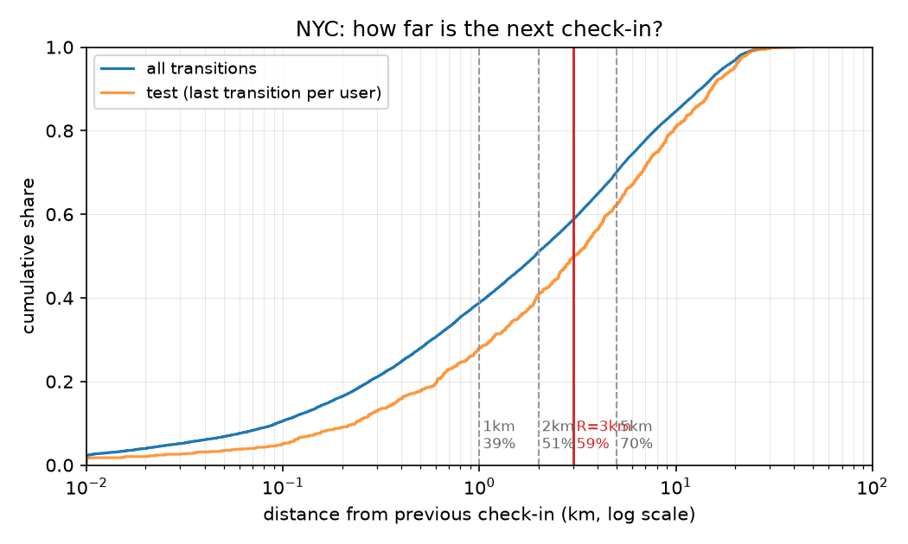
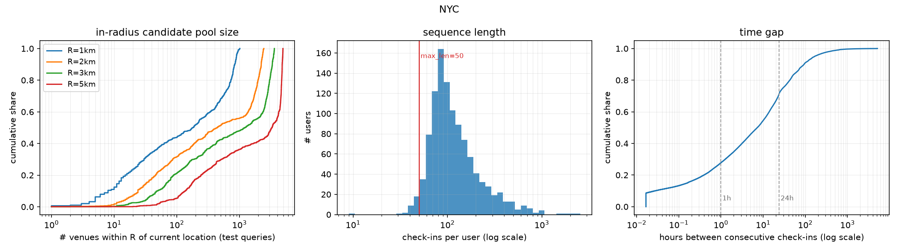

# EDA — NYC

`make eda`로 생성된 파일이에요. 수치를 고치려면 코드를 고치고 다시 생성하세요.

## 결정

- **주 반경 R = 3km** — 직전 장소에서 다음 장소가 반경 안에 들어오는 비율 58.7% (test 정답 기준 49.8% = E4 HR의 상한), 동네 후보 풀은 카탈로그의 12.4% (median)
- 규칙: 후보 [1, 2, 3, 5] 중 동네 후보 풀(test 질의 위치 median)이 카탈로그의 15% 이하인 반경에서 coverage 최대
- 5km는 coverage 70.1%로 더 높지만 동네 후보 풀이 카탈로그의 33.6% (median)라 동네 제약의 대비가 약해져서 제외
- 민감도 분석용 반경: 2km, 5km
- R=3km에서 test 질의 위치 반경 내 장소 수 median 1209, p90 3338 → E2(반경 내 negative 100개)는 대부분 반경 안에서 채워지고, 이웃 CSR은 54.2MB
- `max_len=50`: 유저의 97.3%가 50보다 긴 시퀀스 (median 103)
- 재방문 정답 비율 65.8% (test) → 재방문/신규 분리 리포트 필요

## 표 1. 데이터 통계 (전처리 후)

| 항목 | 값 |
|---|---|
| 유저 | 1,083 |
| 장소 | 9,786 |
| 체크인 | 163,649 |
| 밀도 | 1.54% |
| 카테고리 | 232 |
| 유저당 체크인 (median / mean) | 103 / 151.1 |
| 재방문 정답 비율 (전체 / test) | 68.4% / 65.8% |
| coverage@3km (전체 / test) | 58.7% / 49.8% |
| 기간 (UTC) | 2012-04-03 ~ 2013-02-16 |

### 전처리 단계별 변화

| 단계 | 체크인 | 유저 | 장소 |
|---|---|---|---|
| raw | 227,428 | 1,083 | 38,333 |
| collapse_consecutive_duplicates | 215,078 | 1,083 | 38,333 |
| kcore(user>=5, item>=5) | 163,649 | 1,083 | 9,786 |

장소 대표 좌표(체크인 좌표 중앙값)와 개별 체크인 좌표 차이: median 0m, p99 165m, max 20.9km

## 직전 → 다음 체크인 거리

| | p25 | p50 | p75 | p90 | p99 |
|---|---|---|---|---|---|
| 전체 전이 | 0.41km | 1.92km | 6.18km | 13.41km | 23.68km |
| test 정답 | 0.85km | 3.06km | 8.12km | 15.24km | 24.18km |

## 반경별 coverage — 다음 장소가 반경 안에 있는 비율

| R | 전체 전이 | test 정답 (E4 HR 상한) | 동네 후보 풀 / 카탈로그 (median) |
|---|---|---|---|
| 0.5km | 27.9% | 17.7% | 0.5% |
| 1km | 38.8% | 28.0% | 1.8% |
| 2km | 51.0% | 40.8% | 4.5% |
| 3km ★ | 58.7% | 49.8% | 12.4% |
| 5km | 70.1% | 62.2% | 33.6% |
| 10km | 84.6% | 80.9% | 65.5% |

## 반경 내 장소 수 (자기 자신 포함)

| R | 장소 기준 median / p90 / max | test 질의 위치 기준 median / p90 / max | 이웃 CSR 크기 |
|---|---|---|---|
| 0.5km | 32 / 241 / 336 | 48 / 243 / 328 | 3.4MB |
| 1km | 101 / 817 / 1021 | 179 / 841 / 1015 | 11.3MB |
| 2km | 286 / 2187 / 2456 | 439 / 2223 / 2450 | 32.5MB |
| 3km | 698 / 3286 / 3605 | 1209 / 3338 / 3605 | 54.2MB |
| 5km | 2820 / 4804 / 4946 | 3291 / 4810 / 4942 | 98.2MB |
| 10km | 6295 / 6622 / 6902 | 6410 / 6620 / 6880 | 179.8MB |

## 체크인 간 시간 간격별

| 간격 | 비율 | 재방문 | coverage@1km | coverage@2km | coverage@3km | coverage@5km |
|---|---|---|---|---|---|---|
| <=1h | 27.8% | 76.8% | 62.9% | 73.2% | 78.1% | 84.6% |
| 1-24h | 43.8% | 68.2% | 33.8% | 46.7% | 55.1% | 67.4% |
| >24h | 28.5% | 60.5% | 23.1% | 36.0% | 45.3% | 60.2% |

시간 간격 median 7.3h, p90 93.0h

## 시퀀스 길이

median 103, p90 270, max 2551 · 50보다 긴 유저 97.3%, 100보다 긴 유저 52.3%, 200보다 긴 유저 17.3%

## 상위 카테고리 (체크인 수)

| 카테고리 | 체크인 |
|---|---|
| Bar | 12,562 |
| Home (private) | 11,579 |
| Office | 9,136 |
| Subway | 8,769 |
| Gym / Fitness Center | 7,078 |
| Coffee Shop | 6,067 |
| Train Station | 5,594 |
| Food & Drink Shop | 4,724 |
| Neighborhood | 4,106 |
| Park | 3,831 |
