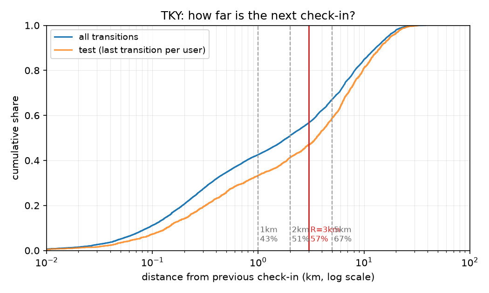
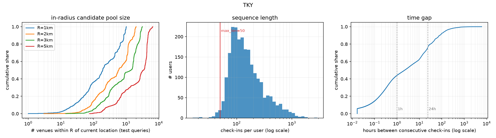

# EDA — TKY

`make eda`로 생성된 파일이에요. 수치를 고치려면 코드를 고치고 다시 생성하세요.

## 결정

- **주 반경 R = 3km** — 직전 장소에서 다음 장소가 반경 안에 들어오는 비율 56.7% (test 정답 기준 47.0% = E4 HR의 상한), 동네 후보 풀은 카탈로그의 9.4% (median)
- 규칙: 후보 [1, 2, 3, 5] 중 동네 후보 풀(test 질의 위치 median)이 카탈로그의 15% 이하인 반경에서 coverage 최대
- 5km는 coverage 67.1%로 더 높지만 동네 후보 풀이 카탈로그의 22.5% (median)라 동네 제약의 대비가 약해져서 제외
- 민감도 분석용 반경: 2km, 5km
- R=3km에서 test 질의 위치 반경 내 장소 수 median 1402, p90 2710 → E2(반경 내 negative 100개)는 대부분 반경 안에서 채워지고, 이웃 CSR은 69.0MB
- `max_len=50`: 유저의 98.7%가 50보다 긴 시퀀스 (median 131)
- 재방문 정답 비율 71.9% (test) → 재방문/신규 분리 리포트 필요

## 표 1. 데이터 통계 (전처리 후)

| 항목 | 값 |
|---|---|
| 유저 | 2,293 |
| 장소 | 14,960 |
| 체크인 | 454,288 |
| 밀도 | 1.32% |
| 카테고리 | 211 |
| 유저당 체크인 (median / mean) | 131 / 198.1 |
| 재방문 정답 비율 (전체 / test) | 68.1% / 71.9% |
| coverage@3km (전체 / test) | 56.7% / 47.0% |
| 기간 (UTC) | 2012-04-03 ~ 2013-02-16 |

### 전처리 단계별 변화

| 단계 | 체크인 | 유저 | 장소 |
|---|---|---|---|
| raw | 573,703 | 2,293 | 61,858 |
| collapse_consecutive_duplicates | 538,465 | 2,293 | 61,858 |
| kcore(user>=5, item>=5) | 454,288 | 2,293 | 14,960 |

장소 대표 좌표(체크인 좌표 중앙값)와 개별 체크인 좌표 차이: median 0m, p99 42m, max 13.6km

## 직전 → 다음 체크인 거리

| | p25 | p50 | p75 | p90 | p99 |
|---|---|---|---|---|---|
| 전체 전이 | 0.26km | 1.88km | 6.75km | 12.91km | 22.75km |
| test 정답 | 0.48km | 3.55km | 8.18km | 14.22km | 24.48km |

## 반경별 coverage — 다음 장소가 반경 안에 있는 비율

| R | 전체 전이 | test 정답 (E4 HR 상한) | 동네 후보 풀 / 카탈로그 (median) |
|---|---|---|---|
| 0.5km | 34.7% | 25.9% | 0.5% |
| 1km | 42.6% | 33.4% | 1.3% |
| 2km | 50.9% | 41.2% | 3.9% |
| 3km ★ | 56.7% | 47.0% | 9.4% |
| 5km | 67.1% | 58.8% | 22.5% |
| 10km | 84.7% | 80.9% | 61.7% |

## 반경 내 장소 수 (자기 자신 포함)

| R | 장소 기준 median / p90 / max | test 질의 위치 기준 median / p90 / max | 이웃 CSR 크기 |
|---|---|---|---|
| 0.5km | 51 / 367 / 682 | 82 / 539 / 680 | 7.1MB |
| 1km | 132 / 786 / 1026 | 190 / 844 / 1012 | 15.5MB |
| 2km | 426 / 1515 / 2018 | 582 / 1761 / 2018 | 37.4MB |
| 3km | 878 / 2595 / 3160 | 1402 / 2710 / 3144 | 69.0MB |
| 5km | 2719 / 4755 / 6593 | 3373 / 4670 / 6524 | 158.5MB |
| 10km | 8920 / 10113 / 10351 | 9224 / 10118 / 10315 | 418.8MB |

## 체크인 간 시간 간격별

| 간격 | 비율 | 재방문 | coverage@1km | coverage@2km | coverage@3km | coverage@5km |
|---|---|---|---|---|---|---|
| <=1h | 44.1% | 68.8% | 56.9% | 64.7% | 69.9% | 78.9% |
| 1-24h | 32.7% | 69.5% | 37.9% | 47.0% | 53.1% | 63.6% |
| >24h | 23.2% | 64.7% | 22.0% | 30.2% | 36.7% | 49.6% |

시간 간격 median 2.2h, p90 79.5h

## 시퀀스 길이

median 131, p90 403, max 2875 · 50보다 긴 유저 98.7%, 100보다 긴 유저 67.6%, 200보다 긴 유저 28.0%

## 상위 카테고리 (체크인 수)

| 카테고리 | 체크인 |
|---|---|
| Train Station | 179,059 |
| Subway | 36,985 |
| Ramen /  Noodle House | 12,241 |
| Convenience Store | 12,049 |
| Food & Drink Shop | 10,846 |
| Electronics Store | 10,292 |
| Mall | 10,036 |
| Bar | 8,581 |
| Japanese Restaurant | 7,682 |
| Coffee Shop | 7,081 |
