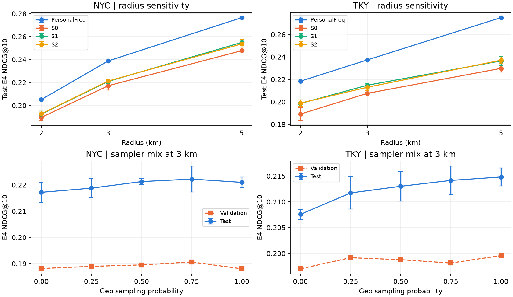

# 반경·혼합 비율·전역 시간 분할 실험

시드 0·1·2로 SASRec을 MPS에서 66회 학습했습니다. 3km 보관 체크포인트 18개는 현재 후보와 평가 코드로 MPS에서 다시 평가했습니다. 베이스라인은 CPU에서 평가했습니다.
보관된 지표와 재평가한 지표의 최대 NDCG@10 차이는 0이었습니다.

체크포인트와 반경·α 선택에는 valid E4 NDCG@10을 사용했습니다. 표는 사전에 정한 모든 설정의 test 결과를 함께 보여줍니다. 반경·α 민감도는 초기 leave-one-out test 결과를 확인한 뒤 진행한 탐색입니다. ±는 세 시드 평균의 표본 표준편차입니다.

전역 분할은 2012-12-01 00:00 UTC 전에 학습 카탈로그·좌표·k-core를 확정하고, 2013-01-01 00:00 UTC부터 test를 평가합니다. 각 기간에는 학습 이용자당 첫 추천 가능 시점을 사용했습니다. 이력은 요청 전 등록 장소만 포함합니다. 카탈로그에 없는 정답은 모든 프로토콜에서 miss입니다. 신규에는 미등록 정답을 포함하며, 등록 신규에는 이용자 미방문 등록 장소만 포함합니다.

## 반경 비교 (leave-one-out)

| 도시 | km | 정답 포함률 | 후보 중앙값 | PersonalFreq E4 | S0 E4 | S1 E4 | S2 E4 | E1 1위 | E4 1위 |
|---|---|---|---|---|---|---|---|---|---|
| NYC | 2 | 40.8% | 438 | 0.2052 | 0.1896 ± 0.0025 | 0.1925 ± 0.0027 | 0.1927 ± 0.0026 | S0 | PersonalFreq |
| NYC | 3 | 49.8% | 1,208 | 0.2388 | 0.2172 ± 0.0038 | 0.2210 ± 0.0020 | 0.2213 ± 0.0012 | S0 | PersonalFreq |
| NYC | 5 | 62.2% | 3,290 | 0.2765 | 0.2478 ± 0.0008 | 0.2549 ± 0.0023 | 0.2537 ± 0.0036 | S0 | PersonalFreq |
| TKY | 2 | 41.2% | 581 | 0.2184 | 0.1891 ± 0.0056 | 0.1986 ± 0.0008 | 0.1989 ± 0.0031 | S0 | PersonalFreq |
| TKY | 3 | 47.0% | 1,401 | 0.2374 | 0.2076 ± 0.0010 | 0.2148 ± 0.0017 | 0.2130 ± 0.0029 | S0 | PersonalFreq |
| TKY | 5 | 58.8% | 3,372 | 0.2751 | 0.2298 ± 0.0033 | 0.2365 ± 0.0043 | 0.2371 ± 0.0030 | S0 | PersonalFreq |

반경 내 정답만 남긴 E4입니다. 반경에 따라 이 표에 포함되는 쿼리가 달라집니다.

| 도시 | km | 반경 내 정답 수 | PersonalFreq | S0 | S1 | S2 |
|---|---|---|---|---|---|---|
| NYC | 2 | 442 | 0.5027 | 0.4647 | 0.4716 | 0.4722 |
| NYC | 3 | 539 | 0.4798 | 0.4364 | 0.4440 | 0.4446 |
| NYC | 5 | 674 | 0.4444 | 0.3981 | 0.4096 | 0.4077 |
| TKY | 2 | 945 | 0.5300 | 0.4589 | 0.4818 | 0.4825 |
| TKY | 3 | 1,078 | 0.5049 | 0.4415 | 0.4569 | 0.4531 |
| TKY | 5 | 1,348 | 0.4679 | 0.3910 | 0.4022 | 0.4033 |

### valid로 선택한 반경

| 도시 | 샘플러 | 선택 km | valid E4 | test E4 |
|---|---|---|---|---|
| NYC | S0 | 5 | 0.2229 | 0.2478 |
| NYC | S1 | 5 | 0.2265 | 0.2549 |
| NYC | S2 | 5 | 0.2266 | 0.2537 |
| TKY | S0 | 5 | 0.2125 | 0.2298 |
| TKY | S1 | 5 | 0.2159 | 0.2365 |
| TKY | S2 | 5 | 0.2156 | 0.2371 |

## 3km 혼합 비율

α는 동네 샘플링을 선택하는 확률입니다. 굵은 α가 도시별 valid E4 선택값입니다.

| 도시 | α | valid E4 | E1 | E3 | E4 | E4 HR@10 | E4 재방문 | E4 신규 | 반경 내 정답만 E4 |
|---|---|---|---|---|---|---|---|---|---|
| NYC | 0 | 0.1881 | 0.7528 | 0.3289 | 0.2172 ± 0.0038 | 0.3102 | 0.3199 | 0.0192 | 0.4364 |
| NYC | 0.25 | 0.1890 | 0.7397 | 0.3320 | 0.2188 ± 0.0036 | 0.3121 | 0.3233 | 0.0175 | 0.4396 |
| NYC | 0.5 | 0.1895 | 0.7289 | 0.3311 | 0.2213 ± 0.0012 | 0.3109 | 0.3270 | 0.0175 | 0.4446 |
| NYC | **0.75** | 0.1906 | 0.7212 | 0.3286 | 0.2222 ± 0.0049 | 0.3155 | 0.3277 | 0.0191 | 0.4465 |
| NYC | 1 | 0.1880 | 0.7025 | 0.2969 | 0.2210 ± 0.0020 | 0.3112 | 0.3270 | 0.0167 | 0.4440 |
| TKY | 0 | 0.1970 | 0.8277 | 0.2955 | 0.2076 ± 0.0010 | 0.3095 | 0.2727 | 0.0413 | 0.4415 |
| TKY | 0.25 | 0.1992 | 0.8144 | 0.2929 | 0.2117 ± 0.0031 | 0.3136 | 0.2799 | 0.0375 | 0.4504 |
| TKY | 0.5 | 0.1988 | 0.7939 | 0.2738 | 0.2130 ± 0.0029 | 0.3163 | 0.2811 | 0.0391 | 0.4531 |
| TKY | 0.75 | 0.1981 | 0.7694 | 0.2423 | 0.2142 ± 0.0028 | 0.3131 | 0.2831 | 0.0379 | 0.4555 |
| TKY | **1** | 0.1996 | 0.7564 | 0.2128 | 0.2148 ± 0.0017 | 0.3141 | 0.2842 | 0.0375 | 0.4569 |

## 전역 시간 분할 재검증 (3km)

| 도시 | 분할 | test 요청 | 미등록 정답 | 정답 포함률 | 재방문율 | E1 1위 | E3 1위 | E4 1위 | E1/E4 순위 τ |
|---|---|---|---|---|---|---|---|---|---|
| NYC | leave-one-out | 1,083 | 0 (0.0%) | 49.8% | 65.8% | S0 | PersonalFreq | PersonalFreq | 0.59 |
| NYC | global-time | 822 | 378 (46.0%) | 24.9% | 34.2% | S0 | PersonalFreq | PersonalFreq | 0.49 |
| TKY | leave-one-out | 2,293 | 0 (0.0%) | 47.0% | 71.9% | S0 | PersonalFreq | PersonalFreq | 0.49 |
| TKY | global-time | 1,983 | 500 (25.2%) | 21.5% | 47.5% | PersonalFreq | PersonalFreq | PersonalFreq | 0.59 |

| 도시 | 분할 | 모델 | E1 | E3 | E4 | E4 HR@10 | 재방문 | 신규 | 등록 신규 | 반경 내 정답만 |
|---|---|---|---|---|---|---|---|---|---|---|
| NYC | leave-one-out | PersonalFreq | 0.7134 | 0.3631 | 0.2388 | 0.3269 | 0.3563 | 0.0123 | 0.0123 | 0.4798 |
| NYC | leave-one-out | GeoPop | 0.3024 | 0.0442 | 0.0442 | 0.0783 | 0.0551 | 0.0233 | 0.0233 | 0.0889 |
| NYC | leave-one-out | S0 | 0.7528 | 0.3289 | 0.2172 ± 0.0038 | 0.3102 | 0.3199 | 0.0192 | 0.0192 | 0.4364 |
| NYC | leave-one-out | S1 | 0.7025 | 0.2969 | 0.2210 ± 0.0020 | 0.3112 | 0.3270 | 0.0167 | 0.0167 | 0.4440 |
| NYC | leave-one-out | S2 | 0.7289 | 0.3311 | 0.2213 ± 0.0012 | 0.3109 | 0.3270 | 0.0175 | 0.0175 | 0.4446 |
| NYC | global-time | PersonalFreq | 0.3822 | 0.1854 | 0.1122 | 0.1545 | 0.3175 | 0.0055 | 0.0184 | 0.4499 |
| NYC | global-time | GeoPop | 0.1550 | 0.0153 | 0.0153 | 0.0262 | 0.0320 | 0.0067 | 0.0223 | 0.0615 |
| NYC | global-time | S0 | 0.3984 | 0.1651 | 0.0977 ± 0.0035 | 0.1399 | 0.2678 | 0.0094 | 0.0311 | 0.3919 |
| NYC | global-time | S1 | 0.3603 | 0.1381 | 0.0962 ± 0.0015 | 0.1407 | 0.2688 | 0.0065 | 0.0214 | 0.3856 |
| NYC | global-time | S2 | 0.3800 | 0.1570 | 0.0949 ± 0.0024 | 0.1383 | 0.2632 | 0.0075 | 0.0250 | 0.3807 |
| TKY | leave-one-out | PersonalFreq | 0.7959 | 0.3721 | 0.2374 | 0.3271 | 0.3264 | 0.0098 | 0.0098 | 0.5049 |
| TKY | leave-one-out | GeoPop | 0.4171 | 0.0708 | 0.0708 | 0.1095 | 0.0877 | 0.0275 | 0.0275 | 0.1506 |
| TKY | leave-one-out | S0 | 0.8277 | 0.2955 | 0.2076 ± 0.0010 | 0.3095 | 0.2727 | 0.0413 | 0.0413 | 0.4415 |
| TKY | leave-one-out | S1 | 0.7564 | 0.2128 | 0.2148 ± 0.0017 | 0.3141 | 0.2842 | 0.0375 | 0.0375 | 0.4569 |
| TKY | leave-one-out | S2 | 0.7939 | 0.2738 | 0.2130 ± 0.0029 | 0.3163 | 0.2811 | 0.0391 | 0.0391 | 0.4531 |
| TKY | global-time | PersonalFreq | 0.5741 | 0.2212 | 0.1100 | 0.1533 | 0.2293 | 0.0022 | 0.0043 | 0.5107 |
| TKY | global-time | GeoPop | 0.2643 | 0.0483 | 0.0483 | 0.0711 | 0.0945 | 0.0066 | 0.0127 | 0.2245 |
| TKY | global-time | S0 | 0.5513 | 0.1574 | 0.0903 ± 0.0011 | 0.1335 | 0.1843 | 0.0054 | 0.0104 | 0.4195 |
| TKY | global-time | S1 | 0.5062 | 0.1147 | 0.0926 ± 0.0017 | 0.1377 | 0.1895 | 0.0052 | 0.0100 | 0.4302 |
| TKY | global-time | S2 | 0.5341 | 0.1512 | 0.0952 ± 0.0018 | 0.1395 | 0.1945 | 0.0056 | 0.0108 | 0.4423 |

분할마다 이용자·정답·카탈로그가 달라집니다. 순위와 샘플러 차이는 각 분할 안에서 해석합니다.

## 샘플러 간 E4 차이

쿼리별로 시드 평균을 구한 뒤 같은 이용자 쿼리를 2,000회 재표집했습니다. 구간은 다중 비교 보정을 적용하기 전의 95% 신뢰구간이며 시드 변동은 위 표에 별도로 표시했습니다.

| 도시 | 분할 | km | 비교 | NDCG 차이 | 95% CI | 상대 차이 |
|---|---|---|---|---|---|---|
| NYC | leave-one-out | 2 | S1 − S0 | +0.0028 | [-0.0023, +0.0080] | +1.5% |
| NYC | leave-one-out | 2 | S2 − S0 | +0.0031 | [-0.0018, +0.0078] | +1.6% |
| NYC | leave-one-out | 3 | S1 − S0 | +0.0038 | [-0.0017, +0.0094] | +1.7% |
| NYC | leave-one-out | 3 | S2 − S0 | +0.0041 | [-0.0007, +0.0092] | +1.9% |
| NYC | leave-one-out | 3 | S2 α=0.25 − S0 | +0.0016 | [-0.0035, +0.0067] | +0.7% |
| NYC | leave-one-out | 3 | S2 α=0.75 − S0 | +0.0051 | [-0.0004, +0.0099] | +2.3% |
| NYC | leave-one-out | 3 | S2 α=0.25 − S2 | -0.0025 | [-0.0071, +0.0020] | -1.1% |
| NYC | leave-one-out | 3 | S2 α=0.75 − S2 | +0.0010 | [-0.0032, +0.0049] | +0.4% |
| NYC | leave-one-out | 5 | S1 − S0 | +0.0072 | [+0.0012, +0.0135] | +2.9% |
| NYC | leave-one-out | 5 | S2 − S0 | +0.0059 | [+0.0002, +0.0119] | +2.4% |
| TKY | leave-one-out | 2 | S1 − S0 | +0.0094 | [+0.0048, +0.0141] | +5.0% |
| TKY | leave-one-out | 2 | S2 − S0 | +0.0097 | [+0.0058, +0.0139] | +5.1% |
| TKY | leave-one-out | 3 | S1 − S0 | +0.0072 | [+0.0027, +0.0118] | +3.5% |
| TKY | leave-one-out | 3 | S2 − S0 | +0.0054 | [+0.0012, +0.0099] | +2.6% |
| TKY | leave-one-out | 3 | S2 α=0.25 − S0 | +0.0041 | [+0.0003, +0.0081] | +2.0% |
| TKY | leave-one-out | 3 | S2 α=0.75 − S0 | +0.0066 | [+0.0017, +0.0114] | +3.2% |
| TKY | leave-one-out | 3 | S2 α=0.25 − S2 | -0.0013 | [-0.0048, +0.0020] | -0.6% |
| TKY | leave-one-out | 3 | S2 α=0.75 − S2 | +0.0011 | [-0.0026, +0.0050] | +0.5% |
| TKY | leave-one-out | 5 | S1 − S0 | +0.0066 | [+0.0016, +0.0115] | +2.9% |
| TKY | leave-one-out | 5 | S2 − S0 | +0.0072 | [+0.0028, +0.0117] | +3.1% |
| NYC | global-time | 3 | S1 − S0 | -0.0016 | [-0.0061, +0.0029] | -1.6% |
| NYC | global-time | 3 | S2 − S0 | -0.0028 | [-0.0065, +0.0006] | -2.9% |
| TKY | global-time | 3 | S1 − S0 | +0.0023 | [-0.0011, +0.0059] | +2.6% |
| TKY | global-time | 3 | S2 − S0 | +0.0049 | [+0.0015, +0.0083] | +5.4% |

전체 모델·구간별 지표는 [실험 매트릭스](matrix.csv), 모든 paired 비교는 [신뢰구간](paired_bootstrap.csv), 분할별 표본은 [코호트](cohorts.csv), 실행 출처는 [입력 목록](inputs.json)에 저장했습니다.
