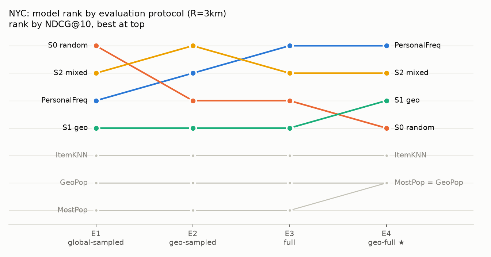
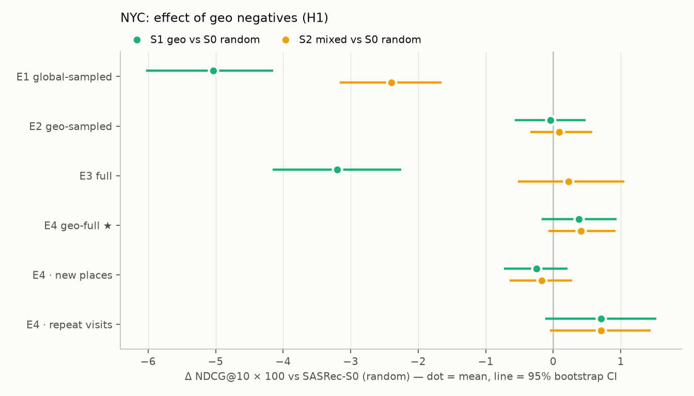

# 모델 비교 — NYC, R=3km (test)

`make compare`로 생성된 파일이에요. 베이스라인은 결정적, SASRec은 시드별 평균의 평균 ± 표준편차.

- SASRec-S0 (random): 시드 3개
- SASRec-S1 (geo): 시드 3개
- SASRec-S2 (mixed): 시드 3개

## 프로토콜별 순위 (H2)

- E1: SASRec-S0 (random) > SASRec-S2 (mixed) > PersonalFreq > SASRec-S1 (geo) > ItemKNN(L=5, decay=1, self=True) > GeoPop > MostPop
- E2: SASRec-S2 (mixed) > PersonalFreq > SASRec-S0 (random) > SASRec-S1 (geo) > ItemKNN(L=5, decay=1, self=True) > GeoPop > MostPop
- E3: PersonalFreq > SASRec-S2 (mixed) > SASRec-S0 (random) > SASRec-S1 (geo) > ItemKNN(L=5, decay=1, self=True) > GeoPop > MostPop
- E4: PersonalFreq > SASRec-S2 (mixed) > SASRec-S1 (geo) > SASRec-S0 (random) > ItemKNN(L=5, decay=1, self=True) > MostPop = GeoPop

E1 순위와 E4 순위의 Kendall τ = 0.59 (1이면 같은 순서, 0이면 무관)

## H1: 샘플러 효과 — S0 대비 NDCG@10 차이 (쿼리 단위 paired bootstrap 2,000회, SASRec은 쿼리별 시드 평균)

| 비교 | 구간 | 차이 (상대) | 95% CI | p |
|---|---|---|---|---|
| S1 geo vs S0 random | E1 | -0.0504 (-6.7%) ✱ | [-0.0603, -0.0414] | 0.000 |
| S2 mixed vs S0 random | E1 | -0.0240 (-3.2%) ✱ | [-0.0316, -0.0165] | 0.000 |
| S1 geo vs S0 random | E2 | -0.0004 (-0.1%) | [-0.0057, +0.0048] | 0.891 |
| S2 mixed vs S0 random | E2 | +0.0009 (+0.2%) | [-0.0034, +0.0058] | 0.680 |
| S1 geo vs S0 random | E3 | -0.0320 (-9.7%) ✱ | [-0.0416, -0.0225] | 0.000 |
| S2 mixed vs S0 random | E3 | +0.0022 (+0.7%) | [-0.0052, +0.0105] | 0.583 |
| S1 geo vs S0 random | E4 | +0.0038 (+1.7%) | [-0.0017, +0.0094] | 0.187 |
| S2 mixed vs S0 random | E4 | +0.0041 (+1.9%) | [-0.0007, +0.0092] | 0.113 |
| S1 geo vs S0 random | E4 new | -0.0025 (-13.0%) | [-0.0073, +0.0021] | 0.310 |
| S2 mixed vs S0 random | E4 new | -0.0017 (-8.9%) | [-0.0064, +0.0028] | 0.477 |
| S1 geo vs S0 random | E4 repeat | +0.0071 (+2.2%) | [-0.0012, +0.0152] | 0.111 |
| S2 mixed vs S0 random | E4 repeat | +0.0071 (+2.2%) | [-0.0005, +0.0144] | 0.072 |

✱ p < 0.05. 신뢰구간은 쿼리(유저) 표본 변동만 반영하고 시드 변동은 위 표의 ± 표준편차로 따로 봐요.

## PersonalFreq 대비 SASRec (NDCG@10, paired bootstrap)

| 비교 | 구간 | 차이 (상대) | 95% CI | p |
|---|---|---|---|---|
| S0 random vs PersonalFreq | E4 | -0.0216 (-9.0%) ✱ | [-0.0296, -0.0135] | 0.000 |
| S1 geo vs PersonalFreq | E4 | -0.0178 (-7.5%) ✱ | [-0.0252, -0.0097] | 0.000 |
| S2 mixed vs PersonalFreq | E4 | -0.0175 (-7.3%) ✱ | [-0.0252, -0.0093] | 0.000 |
| S0 random vs PersonalFreq | E4 new | +0.0069 (+55.6%) ✱ | [+0.0031, +0.0114] | 0.000 |
| S1 geo vs PersonalFreq | E4 new | +0.0044 (+35.4%) | [-0.0001, +0.0088] | 0.056 |
| S2 mixed vs PersonalFreq | E4 new | +0.0051 (+41.7%) | [-0.0003, +0.0116] | 0.060 |
| S0 random vs PersonalFreq | E4 repeat | -0.0364 (-10.2%) ✱ | [-0.0477, -0.0253] | 0.000 |
| S1 geo vs PersonalFreq | E4 repeat | -0.0293 (-8.2%) ✱ | [-0.0405, -0.0184] | 0.000 |
| S2 mixed vs PersonalFreq | E4 repeat | -0.0293 (-8.2%) ✱ | [-0.0404, -0.0182] | 0.000 |

## 표 2. NDCG@10

| 모델 | E1 Global-sampled | E2 Geo-sampled | E3 Full | E4 Geo-full ★ |
|---|---|---|---|---|
| MostPop | 0.1811 | 0.0858 | 0.0274 | 0.0442 |
| GeoPop | 0.3024 | 0.0993 | 0.0442 | 0.0442 |
| PersonalFreq | 0.7134 | 0.3705 | 0.3631 | 0.2388 |
| ItemKNN(L=5, decay=1, self=True) | 0.6597 | 0.3412 | 0.2900 | 0.1933 |
| SASRec-S0 (random) | 0.7528 ± 0.0043 | 0.3703 ± 0.0059 | 0.3289 ± 0.0053 | 0.2172 ± 0.0038 |
| SASRec-S1 (geo) | 0.7025 ± 0.0053 | 0.3699 ± 0.0041 | 0.2969 ± 0.0030 | 0.2210 ± 0.0020 |
| SASRec-S2 (mixed) | 0.7289 ± 0.0065 | 0.3712 ± 0.0003 | 0.3311 ± 0.0051 | 0.2213 ± 0.0012 |

## HR@10

| 모델 | E1 Global-sampled | E2 Geo-sampled | E3 Full | E4 Geo-full ★ |
|---|---|---|---|---|
| MostPop | 0.3049 | 0.1530 | 0.0563 | 0.0783 |
| GeoPop | 0.4390 | 0.1755 | 0.0783 | 0.0783 |
| PersonalFreq | 0.7413 | 0.3818 | 0.5291 | 0.3269 |
| ItemKNN(L=5, decay=1, self=True) | 0.7130 | 0.3700 | 0.4523 | 0.2857 |
| SASRec-S0 (random) | 0.8264 ± 0.0051 | 0.4069 ± 0.0014 | 0.5048 ± 0.0066 | 0.3102 ± 0.0040 |
| SASRec-S1 (geo) | 0.7753 ± 0.0046 | 0.4020 ± 0.0028 | 0.4746 ± 0.0082 | 0.3112 ± 0.0065 |
| SASRec-S2 (mixed) | 0.7990 ± 0.0047 | 0.4014 ± 0.0019 | 0.5002 ± 0.0075 | 0.3109 ± 0.0005 |

## 표 3. 재방문 / 신규 정답별 NDCG@10

| 모델 | E3 재방문 | E3 신규 | E4 재방문 | E4 신규 |
|---|---|---|---|---|
| MostPop | 0.0248 | 0.0323 | 0.0551 | 0.0233 |
| GeoPop | 0.0551 | 0.0233 | 0.0551 | 0.0233 |
| PersonalFreq | 0.5515 | 0.0000 | 0.3563 | 0.0123 |
| ItemKNN(L=5, decay=1, self=True) | 0.4390 | 0.0027 | 0.2869 | 0.0130 |
| SASRec-S0 (random) | 0.4946 ± 0.0096 | 0.0096 ± 0.0032 | 0.3199 ± 0.0062 | 0.0192 ± 0.0017 |
| SASRec-S1 (geo) | 0.4411 ± 0.0065 | 0.0189 ± 0.0046 | 0.3270 ± 0.0021 | 0.0167 ± 0.0022 |
| SASRec-S2 (mixed) | 0.4971 ± 0.0082 | 0.0113 ± 0.0028 | 0.3270 ± 0.0034 | 0.0175 ± 0.0030 |

## 정답이 동네 안인 쿼리만 NDCG@10 — negative 난이도 효과

| 모델 | E1 Global-sampled | E2 Geo-sampled | E3 Full | E4 Geo-full ★ |
|---|---|---|---|---|
| MostPop | 0.1669 | 0.1723 | 0.0192 | 0.0889 |
| GeoPop | 0.5473 | 0.1995 | 0.0889 | 0.0889 |
| PersonalFreq | 0.7392 | 0.7444 | 0.4001 | 0.4798 |
| ItemKNN(L=5, decay=1, self=True) | 0.7090 | 0.6855 | 0.3071 | 0.3885 |
| SASRec-S0 (random) | 0.7828 ± 0.0088 | 0.7441 ± 0.0119 | 0.3594 ± 0.0085 | 0.4364 ± 0.0077 |
| SASRec-S1 (geo) | 0.7288 ± 0.0039 | 0.7433 ± 0.0082 | 0.3120 ± 0.0044 | 0.4440 ± 0.0040 |
| SASRec-S2 (mixed) | 0.7569 ± 0.0033 | 0.7459 ± 0.0006 | 0.3556 ± 0.0093 | 0.4446 ± 0.0025 |

## 직전 체크인과의 시간 간격별 NDCG@10 (E4)

| 모델 | <=1h | 1-24h | >24h |
|---|---|---|---|
| MostPop | 0.1002 | 0.0560 | 0.0258 |
| GeoPop | 0.1002 | 0.0560 | 0.0258 |
| PersonalFreq | 0.3980 | 0.2535 | 0.1956 |
| ItemKNN(L=5, decay=1, self=True) | 0.3299 | 0.1912 | 0.1636 |
| SASRec-S0 (random) | 0.3869 ± 0.0149 | 0.2194 ± 0.0062 | 0.1778 ± 0.0063 |
| SASRec-S1 (geo) | 0.3847 ± 0.0135 | 0.2280 ± 0.0017 | 0.1806 ± 0.0027 |
| SASRec-S2 (mixed) | 0.3887 ± 0.0173 | 0.2244 ± 0.0069 | 0.1820 ± 0.0028 |
