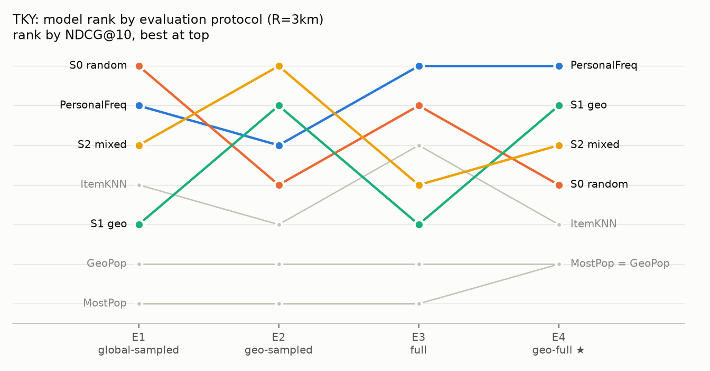
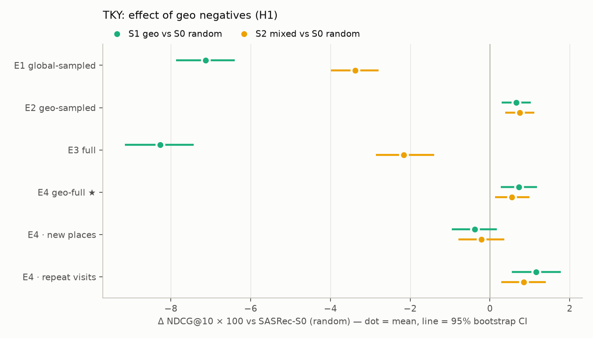

# 모델 비교 — TKY, R=3km (test)

`make compare`로 생성된 파일이에요. 베이스라인은 결정적, SASRec은 시드별 평균의 평균 ± 표준편차.

- SASRec-S0 (random): 시드 3개
- SASRec-S1 (geo): 시드 3개
- SASRec-S2 (mixed): 시드 3개

## 프로토콜별 순위 (H2)

- E1: SASRec-S0 (random) > PersonalFreq > SASRec-S2 (mixed) > ItemKNN(L=all, decay=1, self=True) > SASRec-S1 (geo) > GeoPop > MostPop
- E2: SASRec-S2 (mixed) > SASRec-S1 (geo) > PersonalFreq > SASRec-S0 (random) > ItemKNN(L=all, decay=1, self=True) > GeoPop > MostPop
- E3: PersonalFreq > SASRec-S0 (random) > ItemKNN(L=all, decay=1, self=True) > SASRec-S2 (mixed) > SASRec-S1 (geo) > GeoPop > MostPop
- E4: PersonalFreq > SASRec-S1 (geo) > SASRec-S2 (mixed) > SASRec-S0 (random) > ItemKNN(L=all, decay=1, self=True) > MostPop = GeoPop

E1 순위와 E4 순위의 Kendall τ = 0.49 (1이면 같은 순서, 0이면 무관)

## H1: 샘플러 효과 — S0 대비 NDCG@10 차이 (쿼리 단위 paired bootstrap 2,000회, SASRec은 쿼리별 시드 평균)

| 비교 | 구간 | 차이 (상대) | 95% CI | p |
|---|---|---|---|---|
| S1 geo vs S0 random | E1 | -0.0713 (-8.6%) ✱ | [-0.0787, -0.0640] | 0.000 |
| S2 mixed vs S0 random | E1 | -0.0338 (-4.1%) ✱ | [-0.0399, -0.0280] | 0.000 |
| S1 geo vs S0 random | E2 | +0.0066 (+1.7%) ✱ | [+0.0029, +0.0102] | 0.000 |
| S2 mixed vs S0 random | E2 | +0.0074 (+2.0%) ✱ | [+0.0038, +0.0112] | 0.000 |
| S1 geo vs S0 random | E3 | -0.0827 (-28.0%) ✱ | [-0.0916, -0.0743] | 0.000 |
| S2 mixed vs S0 random | E3 | -0.0216 (-7.3%) ✱ | [-0.0285, -0.0140] | 0.000 |
| S1 geo vs S0 random | E4 | +0.0072 (+3.5%) ✱ | [+0.0027, +0.0118] | 0.000 |
| S2 mixed vs S0 random | E4 | +0.0054 (+2.6%) ✱ | [+0.0012, +0.0099] | 0.011 |
| S1 geo vs S0 random | E4 new | -0.0038 (-9.2%) | [-0.0096, +0.0017] | 0.191 |
| S2 mixed vs S0 random | E4 new | -0.0022 (-5.3%) | [-0.0079, +0.0036] | 0.468 |
| S1 geo vs S0 random | E4 repeat | +0.0116 (+4.2%) ✱ | [+0.0055, +0.0177] | 0.000 |
| S2 mixed vs S0 random | E4 repeat | +0.0084 (+3.1%) ✱ | [+0.0028, +0.0140] | 0.003 |

✱ p < 0.05. 신뢰구간은 쿼리(유저) 표본 변동만 반영하고 시드 변동은 위 표의 ± 표준편차로 따로 봐요.

## PersonalFreq 대비 SASRec (NDCG@10, paired bootstrap)

| 비교 | 구간 | 차이 (상대) | 95% CI | p |
|---|---|---|---|---|
| S0 random vs PersonalFreq | E4 | -0.0298 (-12.5%) ✱ | [-0.0374, -0.0226] | 0.000 |
| S1 geo vs PersonalFreq | E4 | -0.0225 (-9.5%) ✱ | [-0.0297, -0.0161] | 0.000 |
| S2 mixed vs PersonalFreq | E4 | -0.0243 (-10.3%) ✱ | [-0.0315, -0.0176] | 0.000 |
| S0 random vs PersonalFreq | E4 new | +0.0315 (+322.5%) ✱ | [+0.0232, +0.0403] | 0.000 |
| S1 geo vs PersonalFreq | E4 new | +0.0277 (+283.6%) ✱ | [+0.0200, +0.0360] | 0.000 |
| S2 mixed vs PersonalFreq | E4 new | +0.0293 (+300.0%) ✱ | [+0.0217, +0.0381] | 0.000 |
| S0 random vs PersonalFreq | E4 repeat | -0.0538 (-16.5%) ✱ | [-0.0643, -0.0444] | 0.000 |
| S1 geo vs PersonalFreq | E4 repeat | -0.0422 (-12.9%) ✱ | [-0.0523, -0.0336] | 0.000 |
| S2 mixed vs PersonalFreq | E4 repeat | -0.0453 (-13.9%) ✱ | [-0.0552, -0.0366] | 0.000 |

## 표 2. NDCG@10

| 모델 | E1 Global-sampled | E2 Geo-sampled | E3 Full | E4 Geo-full ★ |
|---|---|---|---|---|
| MostPop | 0.3707 | 0.1584 | 0.0587 | 0.0708 |
| GeoPop | 0.4171 | 0.1594 | 0.0708 | 0.0708 |
| PersonalFreq | 0.7959 | 0.3782 | 0.3721 | 0.2374 |
| ItemKNN(L=all, decay=1, self=True) | 0.7881 | 0.3712 | 0.2924 | 0.1992 |
| SASRec-S0 (random) | 0.8277 ± 0.0012 | 0.3763 ± 0.0046 | 0.2955 ± 0.0022 | 0.2076 ± 0.0010 |
| SASRec-S1 (geo) | 0.7564 ± 0.0023 | 0.3829 ± 0.0017 | 0.2128 ± 0.0075 | 0.2148 ± 0.0017 |
| SASRec-S2 (mixed) | 0.7939 ± 0.0087 | 0.3838 ± 0.0050 | 0.2738 ± 0.0115 | 0.2130 ± 0.0029 |

## HR@10

| 모델 | E1 Global-sampled | E2 Geo-sampled | E3 Full | E4 Geo-full ★ |
|---|---|---|---|---|
| MostPop | 0.5287 | 0.2283 | 0.1051 | 0.1095 |
| GeoPop | 0.5889 | 0.2305 | 0.1095 | 0.1095 |
| PersonalFreq | 0.8415 | 0.3958 | 0.5495 | 0.3271 |
| ItemKNN(L=all, decay=1, self=True) | 0.8555 | 0.4039 | 0.4379 | 0.2931 |
| SASRec-S0 (random) | 0.9006 ± 0.0050 | 0.4210 ± 0.0032 | 0.4868 ± 0.0038 | 0.3095 ± 0.0038 |
| SASRec-S1 (geo) | 0.8631 ± 0.0047 | 0.4195 ± 0.0036 | 0.3502 ± 0.0042 | 0.3141 ± 0.0022 |
| SASRec-S2 (mixed) | 0.8759 ± 0.0026 | 0.4194 ± 0.0031 | 0.4428 ± 0.0230 | 0.3163 ± 0.0038 |

## 표 3. 재방문 / 신규 정답별 NDCG@10

| 모델 | E3 재방문 | E3 신규 | E4 재방문 | E4 신규 |
|---|---|---|---|---|
| MostPop | 0.0750 | 0.0170 | 0.0877 | 0.0275 |
| GeoPop | 0.0877 | 0.0275 | 0.0877 | 0.0275 |
| PersonalFreq | 0.5177 | 0.0000 | 0.3264 | 0.0098 |
| ItemKNN(L=all, decay=1, self=True) | 0.4050 | 0.0047 | 0.2685 | 0.0221 |
| SASRec-S0 (random) | 0.4024 ± 0.0025 | 0.0222 ± 0.0020 | 0.2727 ± 0.0008 | 0.0413 ± 0.0020 |
| SASRec-S1 (geo) | 0.2935 ± 0.0108 | 0.0066 ± 0.0013 | 0.2842 ± 0.0021 | 0.0375 ± 0.0013 |
| SASRec-S2 (mixed) | 0.3765 ± 0.0159 | 0.0115 ± 0.0015 | 0.2811 ± 0.0037 | 0.0391 ± 0.0015 |

## 정답이 동네 안인 쿼리만 NDCG@10 — negative 난이도 효과

| 모델 | E1 Global-sampled | E2 Geo-sampled | E3 Full | E4 Geo-full ★ |
|---|---|---|---|---|
| MostPop | 0.3209 | 0.3369 | 0.0492 | 0.1506 |
| GeoPop | 0.7414 | 0.3391 | 0.1506 | 0.1506 |
| PersonalFreq | 0.8011 | 0.8045 | 0.3817 | 0.5049 |
| ItemKNN(L=all, decay=1, self=True) | 0.8096 | 0.7895 | 0.3063 | 0.4237 |
| SASRec-S0 (random) | 0.8865 ± 0.0025 | 0.8005 ± 0.0098 | 0.3680 ± 0.0043 | 0.4415 ± 0.0020 |
| SASRec-S1 (geo) | 0.7807 ± 0.0063 | 0.8145 ± 0.0036 | 0.2386 ± 0.0107 | 0.4569 ± 0.0037 |
| SASRec-S2 (mixed) | 0.8234 ± 0.0145 | 0.8163 ± 0.0106 | 0.3081 ± 0.0123 | 0.4531 ± 0.0061 |

## 직전 체크인과의 시간 간격별 NDCG@10 (E4)

| 모델 | <=1h | 1-24h | >24h |
|---|---|---|---|
| MostPop | 0.0991 | 0.0736 | 0.0515 |
| GeoPop | 0.0991 | 0.0736 | 0.0515 |
| PersonalFreq | 0.3238 | 0.2337 | 0.1864 |
| ItemKNN(L=all, decay=1, self=True) | 0.2672 | 0.1944 | 0.1603 |
| SASRec-S0 (random) | 0.3093 ± 0.0016 | 0.1967 ± 0.0047 | 0.1519 ± 0.0007 |
| SASRec-S1 (geo) | 0.3137 ± 0.0017 | 0.2083 ± 0.0064 | 0.1580 ± 0.0019 |
| SASRec-S2 (mixed) | 0.3080 ± 0.0055 | 0.2069 ± 0.0088 | 0.1584 ± 0.0039 |
